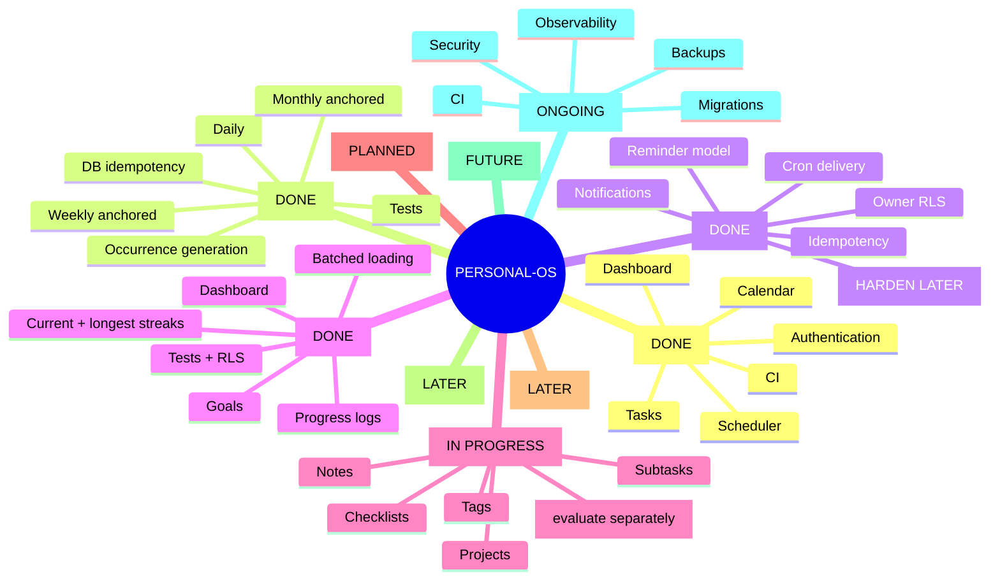

# Personal-OS — Persistent Project State

> Canonical recovery checkpoint. Read this before making project claims or changes.
> Last reconciled: 2026-11-17. Code-bearing head 8d3667ae8aa843ef6e6fe6a62c9df2480cd63265 passed [CI #204](https://github.com/mohith-krishnaa/personal-os/actions/runs/44054528518): full 15-migration PostgreSQL 17 replay, two-owner RLS including cross-owner UPDATE/DELETE denial for projects, tasks, and both checklist tables, hierarchy concurrency, application tests, typecheck, and production build. No lint script/configuration exists.

## Current verified state

- Stable integration branch: `main` at `2b42dd17796b75dca79434a81d4e1f0cbf0fa043`.
- Recurring Tasks V1 and Reminders V1 are merged. Progress & Streaks V1 application code is present, but live schema compatibility is incomplete: the live `public.goals` table lacks `unit` and `target`.
- Active development branch: `feature/organization-v1`. PR #11 is the intended Organization V1 review path; this run did not merge it. Recheck the live PR page for its current state/head before any merge. PR #12 was previously marked as superseded and should not be merged separately.
- Latest code-bearing checkpoint 8d3667ae8aa843ef6e6fe6a62c9df2480cd63265 passed [CI #204](https://github.com/mohith-krishnaa/personal-os/actions/runs/44054528518). The run completed the full 15-migration PostgreSQL 17 replay, authenticated two-owner RLS checks (including cross-owner UPDATE/DELETE denial for projects, tasks, canonical checklist items, and legacy checklist items), hierarchy concurrency integration, application tests, TypeScript typecheck, and production build. No lint script/configuration exists; CI does not define a lint step.
- Live Supabase project `gujzvkyytxsnervovvrt`: `ACTIVE_HEALTHY`, region ap-southeast-1, PostgreSQL 17.11.0.003.
- Live migration ledger: 8 applied core migrations. The branch contains 15 numbered SQL migrations: 8 matching the live ledger, 6 Organization migrations, and 1 Progress goal-metrics compatibility migration. The latter 7 are unapplied in production.
- Live public schema: 9 application tables, all RLS-enabled and all reporting zero rows. `projects` has `title` but no `name`; `checklist_items` and `task_checklist_items` are absent; the Organization task validation trigger is absent; `goals` lacks `unit` and `target`.
- Security advisor returned no lints. Performance advisor findings: 4 unindexed foreign keys, 14 auth RLS initialization-plan warnings, 13 unused-index findings, and 4 overlapping permissive policies on `goals`.
- The Free Plan has no scheduled backups. No private schema/data/role export or successful isolated restore test exists.
- No production DDL, migration, RLS change, data write, restore, or PR merge was performed in this checkpoint.
- Roadmap priority: Organization V1 remains the highest-priority incomplete milestone. Analytics remains queued until recovery is proven and authenticated direct-API isolation is tested against a restored snapshot.

## Source-of-truth hierarchy

1. Actual GitHub repository and branch contents
2. Actual Supabase schema/data contract
3. CI/test results
4. `PROJECT_STATE.md`
5. `PROJECT_ROADMAP.md`
6. Chat history/memory

If sources disagree, verify the higher-priority source. Never guess.

## Anti-confusion protocol

Before every substantial change:
1. Read roadmap and project state.
2. Verify active branch and PR state.
3. Inspect relevant code.
4. Verify live Supabase schema for DB changes.
5. Make the smallest safe change.
6. Run CI/tests/build where applicable.
7. Re-read changed files and verify the result.
8. Update this checkpoint after milestones.
9. Never report a change as verified until the authoritative system confirms it.

Branches are not PRs. A Compare & pull request button only means a branch has changes relative to its base.

## Latest checkpoint — partial task relationship update semantics (2026-11-17)

- Live PR #11 remains open, unmerged, non-draft, and mergeable. Latest head: `b2526b832281e55c3feaaf854341dbf11af94e97`.
- Extracted `resolveTaskOrganizationLinks` and used it in `updateTask` so omitted relationship fields preserve the existing project/parent link, while an explicit `null` clears only the requested link.
- Added two regression tests covering partial parent changes and explicit-null clearing. Existing owner-scoped preflight and database trigger behavior are unchanged.
- [CI #156](https://github.com/mohith-krishnaa/personal-os/actions/runs/44016733596) passed on this exact code head: **56 tests passed, 0 failed**; `npm run typecheck` and `npm run build` passed. All configured workflow steps completed successfully.
- Lint remains unavailable because no lint script/configuration exists. CI uses `npm install`; no lockfile is present, so dependency resolution is not pinned.
- Supabase project metadata reports `ACTIVE_HEALTHY`, but migration listing, verbose table inspection, and a read-only `select now()` query time out. Security/performance advisors report hibernation. The live migration ledger and schema remain unknown; recent unified-log query returned no Postgres log rows in its default window.
- No production migration, schema/data write, RLS change, or PR merge was performed.

Next safe action: create and restore-test a private schema/data/role backup, then test the complete six-migration sequence and authenticated two-user direct-API isolation against a disposable database matching the live schema. Keep Analytics queued until Organization's production gates pass.

## Latest checkpoint — CI action runtime upgrade (2026-11-17)

- Upgraded `.github/workflows/ci.yml` from `actions/checkout@v4` and `actions/setup-node@v4` to v5. The upstream action manifests declare `runs.using: node24`.
- This removes the Node 20 deprecation warning observed in CI #157 while retaining the explicit Node 24 setup.
- [CI #158](https://github.com/mohith-krishnaa/personal-os/actions/runs/44017017543) passed on PR #11 head `6217e100777543ecc65590dbc1156ebd4dfc0aca`: **56 tests passed, 0 failed**; typecheck and production build passed; npm install reported 0 vulnerabilities. The current workflow's install, test, typecheck, and build steps all succeeded.
- No application code, schema, migration, RLS policy, or production data changed in this CI-only follow-up.
- No lint script/configuration or package lockfile exists. Exact dependency versions therefore remain unpinned.
- Supabase live schema/migration inspection remains blocked by connection timeouts and advisor hibernation responses.

## Completed milestones

### Recurring Tasks V1 — COMPLETE
- Daily, weekly and monthly recurrence rules.
- Weekly cycle anchoring.
- Monthly day 29–31 clamping with preserved anchor day.
- Recurrence validation and creation UI.
- Next-occurrence generation after completion.
- Activity events and guarded completion updates.
- Shared recurrence types and regression tests.
- Supabase partial unique index for recurring occurrence idempotency.
- PostgreSQL `23505` handling.
- Reproducible migration.
- V1 occurrence-only editing semantics.
- Full timezone/DST recurrence semantics remain deferred.

### Reminders V1 — COMPLETE
- Owner-scoped reminders and notifications with RLS.
- Task ownership validation.
- Scheduled timestamp + timezone field.
- `IN_APP` channel.
- Upcoming-reminder query and server action boundary.
- Authenticated cron delivery endpoint.
- Durable notification records and delivery idempotency.
- Activity events, dashboard scheduling/upcoming UI.
- Validation tests, cron configuration and CI verification.
- Full user-local timezone/DST semantics remain a hardening item.

### Progress & Streaks V1 — COMPLETE
- Generic measurable goals with positive targets.
- Positive progress entries with date validation.
- Current and longest streak calculations; duplicate entries on one day count once.
- Dashboard goal cards, progress logging, percentage and streak display.
- Goals/progress migration with owner-scoped RLS and positive-value constraints.
- Batched dashboard loading to avoid N+1 progress queries.
- Authenticated `user_id` enforced at the service boundary.
- Progress unit tests included in the repository test command.
- PR #8 merged to `main`.

## Security / hardening status

- `public.rls_auto_enable()` client execution restricted; security issue #6 closed.
- Security verification reported 0 advisor lints after remediation.
- Foreign-key indexing/performance findings should still be reviewed during production hardening.
- CI/build must remain a merge gate for future work.

## Roadmap

1. Recurring Tasks V1 — DONE
2. Reminders V1 — DONE
3. Progress & Streaks V1 — DONE
4. **Organization V1 — IN PROGRESS (PR #11; live schema inspected, backup and rollout gates pending)**
5. Analytics V1
6. AI Assistant V1
7. Research Agent V1
8. Adaptive Scheduling
9. Production hardening

## Mind tree

## Definition of done — every feature

A feature is not complete merely because the UI works. Where applicable, verify:
1. Data model/schema
2. Authorization/RLS
3. Backend/application logic
4. Edge cases and failure states
5. Unit/integration/regression tests
6. UI/UX
7. CI/build
8. Migration/recovery implications
9. Documentation + `PROJECT_STATE.md`

## Future-session rule

Never infer progress from chat wording. Verify GitHub branch/PR state, inspect relevant files, verify Supabase for data changes, verify CI, and update this checkpoint. If uncertain, mark it uncertain and continue verification rather than guessing.

## Historical Organization V1 checkpoint — 2026-10-16

The following observations were made on 2026-10-16 and are retained for traceability, not as a claim about the current live database:

- Organization V1 implementation was under PR #11 on `feature/organization-v1`.
- The intended Supabase project was `gujzvkyytxsnervovvrt`; at that time the migration ledger and schema were reported as accessible, with Organization migrations not yet applied.
- The branch included owner-scoped projects, task/project associations, subtasks, checklist CRUD, ownership hardening, legacy checklist reconciliation, cycle prevention, and the project-name compatibility migration.
- Earlier CI runs #95 and #96 passed. These are historical checks and do not replace final-head verification.

## Organization V1 — current checkpoint (2026-11-16)

- GitHub confirms `main` is at `2b42dd17796b75dca79434a81d4e1f0cbf0fa043`.
- PR #11 is open, unmerged, non-draft, and mergeable; it targets `main`. Its verified head at the start of this checkpoint was `aa26a556cd6627a0ccd19efd914fe62be76f0ed9`.
- CI run #104 (ID `43928396020`) passed on commit `f2b9e43564663c74ac51e7f1e2356163633e21c3`: dependency installation, `npm run test`, `npm run typecheck`, and `npm run build` all succeeded. This predates the current documentation-only refresh; verify the newest head's CI before merge.
- Supabase project metadata for `gujzvkyytxsnervovvrt` reports `ACTIVE_HEALTHY`, but live migration listing, table introspection, read-only SQL, and advisor calls failed with connection timeouts. Advisor calls reported that the project was hibernated. Therefore the current live migration ledger and schema are **unknown**, not verified.
- No Organization migration was applied in this checkpoint, and no production schema or data was changed.
- Do not merge PR #11 or start Analytics until the live migration ledger/schema can be read, migration compatibility is reviewed against that state, recovery readiness is confirmed, migrations are applied safely, advisors are checked, and authenticated CRUD plus cross-user isolation pass.

## Organization V1 implementation contract (branch state; not a live-deployment claim)

- Projects, tasks, subtasks, and checklist records are owner-scoped. Application checks provide defense in depth; PostgreSQL RLS and task-link validation triggers are intended to enforce the database boundary.
- A task's project and parent task must belong to the same owner; a subtask must remain in the same project as its parent. The hierarchy trigger rejects self-parenting and indirect cycles.
- `checklist_items` is the canonical application table. The legacy `task_checklist_items` table is retained and reconciled forward rather than dropped.
- The project compatibility migration bridges legacy `projects.title` and application-facing `projects.name` without dropping the legacy column.
- These are repository implementation contracts. Their live production state remains unverified until Supabase introspection succeeds.

## Organization V1 — current checkpoint (2026-11-17)

- Repository: `mohith-krishnaa/personal-os`; stable `main` remains at `2b42dd17796b75dca79434a81d4e1f0cbf0fa043`.
- PR #11 remains open and unmerged on `feature/organization-v1`. The live PR page is authoritative for its current head and mergeability.
- PR #12 (`fix/project-schema-compatibility`) remains an open draft explicitly marked superseded by PR #11. Do not merge it separately; its compatibility migration is already integrated into PR #11.
- CI run #115 (ID `43938573918`) passed on PR head `91cd88fedef768a65286381c361b72f46d67ee29`: `npm install`, `npm run test`, `npm run typecheck`, and `npm run build` succeeded.
- Organization project tests now verify that `createProject` derives `user_id` from `auth.getUser()`, `updateProject` filters by both project ID and authenticated user ID, and unauthenticated updates do not reach the database client. These are application-service tests using mocked Supabase clients, not live RLS tests.
- Added the architecture/decision record at `docs/architecture/organization-v1.md`. It documents the RLS trust boundary, owner/project/task/checklist invariants, forward-only compatibility intent, and the fail-closed production rollout rule.
- No lint script or linter configuration exists; no lint result is claimed.
- Supabase project metadata reports `ACTIVE_HEALTHY`, but repeated `list_migrations` and verbose `list_tables` calls time out. A read-only `select now()` probe also times out. Security/performance advisor calls report that the project is hibernated. Live migration ledger and table definitions remain **unknown**.
- No migrations were applied and no production schema or data was changed. PR #11 was not merged.
- Organization V1 remains incomplete until the live ledger/schema are inspected, backup/recovery readiness is confirmed, reviewed migrations are applied safely, advisors are checked, and authenticated CRUD plus cross-user isolation pass.

Next safe action: restore supported database connectivity and inspect the actual live migration ledger and Organization tables before attempting any DDL or merge.

## Organization V1 — subtask visibility checkpoint (2026-11-17)

- PR #11 remains open and unmerged on `feature/organization-v1`; its live page is authoritative for current head/mergeability. PR #12 remains a draft explicitly superseded by PR #11.
- Added `listSubtasksAction` in `src/app/dashboard/subtask-actions.ts`. It creates the authenticated server-side Supabase client, resolves the user with `auth.getUser()`, and delegates to the owner-scoped service.
- `listSubtasks` verifies that the parent belongs to the supplied user and filters the child query by both `user_id` and `parent_task_id`.
- Updated `SubtaskManager` to lazy-load direct subtasks when expanded, display their completion state, and update completion through the existing `toggleTaskAction`. Subtask creation remains available. This is a one-level dashboard view; recursive hierarchy navigation is not implemented by this change.
- Added two tests: one asserts the child query's owner/parent filters and stable ordering; one asserts that a foreign-owned parent prevents child listing.
- CI run #120 (ID `43947823009`) passed on implementation commit `b8a686664e5e39b2ebc042192a9ea291c6d1bec7`: **33 passed, 0 failed**, typecheck passed, production build passed, and npm audit reported 0 vulnerabilities. Recheck the live PR checks on any later documentation commit before merge.
- No lint script or linter configuration exists; lint is not verified.
- Supabase metadata reports `ACTIVE_HEALTHY`; `list_migrations`, verbose `list_tables`, and read-only SQL continue to time out. Security/performance advisor calls report the project hibernated. Live migration ledger/schema remain unknown.
- No production DDL, migration, data write, or PR merge was performed.

Next safe action: restore supported database connectivity, inspect the actual migration ledger and Organization tables, confirm recovery readiness, then proceed with reviewed migrations, advisors, and authenticated two-user CRUD/isolation tests.

## Organization V1 — subtask create/list consistency (2026-11-17)

- Live PR #11 pre-change head: `b466ee0ba32cae5b4a1763db50360a69e132ca28`; PR #11 remains open/unmerged and PR #12 remains a superseded draft.
- Fixed a partial-list state bug in `SubtaskManager`: creating a subtask after a failed initial read previously set `loaded=true`, which could hide pre-existing children.
- Added `afterSubtaskCreated` state transition logic. A loaded list appends without another request; an incomplete list remains incomplete and is refreshed through `listSubtasksAction`. If refresh fails, the created row remains visible and retry stays available.
- The Add control is disabled during a list read to avoid overlapping requests.
- Added two regression tests for loaded and incomplete list transitions. CI run #122 (ID `43959430815`) passed on implementation commit `3de585c8a2ba7e511f50ed0cd0be8c37d9bd1bf2`: 35 tests, typecheck, and production build passed; npm install reported 0 vulnerabilities.
- This is a UI/state correctness change only; no migration, schema, database privilege, or authorization boundary changed.
- Supabase project metadata reports `ACTIVE_HEALTHY`, but live migration listing, table introspection, read-only SQL, and advisors fail due timeouts/hibernation. Live schema and migration ledger remain unknown.
- No production migration, schema/data write, or PR merge was performed.

## Organization V1 — checklist create/list recovery (2026-11-17)

- Live inspection confirms PR #11 remains open, unmerged, non-draft, and mergeable at the start of this change. PR #12 remains an open draft explicitly superseded by PR #11.
- Found the analogous checklist state bug previously fixed in subtasks: after a failed checklist list read, a successful create appended only the new item and did not refresh the canonical owner-scoped list, so pre-existing checklist rows could remain hidden.
- Added `afterChecklistItemCreated` in `src/lib/checklist-state.ts`. A create on a successfully loaded list is inserted in the same `position` then `created_at` order used by the service. A create while the list is incomplete retains the new row and requests a canonical reload.
- Updated `ChecklistManager` to track whether the latest list read succeeded, refresh after creates on an incomplete list, preserve created rows if that refresh fails, expose a Retry action, and disable Add while a read is in flight.
- Added three regression tests covering ordering on a loaded list, reload after an incomplete read, and retaining the created row while the list remains incomplete. These tests are included in the existing `npm run test` command.
- No schema, migration, RLS, database privilege, or authenticated server-action behavior changed. The existing checklist server action still resolves the user via `auth.getUser()`, and service reads/writes retain owner and task filters.
- Current PR head before documentation reconciliation: implementation commits `b97d0111888d775214a749ceed33e0fd9a3fa896`, `9ef8704e1f62d1eb90baae7d946484cd436d8f57`, and `a79eb00412e2fd232fa99c3c3269d83ee2014d95`. CI for the new implementation must be checked against the final documentation head before merge.
- Supabase project metadata still reports `ACTIVE_HEALTHY`, but live migration listing and verbose table introspection both failed with connection timeouts during this run. The live schema and migration ledger remain unknown.
- No production migration, schema/data write, or PR merge was performed.

Next safe action: verify CI on the latest PR head, then restore supported Supabase database access and inspect the live migration ledger/schema before any DDL or merge.

## Latest verified checkpoint — checklist recovery (2026-11-17)

- PR #11 is open, unmerged, non-draft, and mergeable at live verification; PR #12 remains an open draft superseded by PR #11.
- Checklist create/list recovery is implemented in `ChecklistManager`. A create after a failed/incomplete list read keeps the new row visible and reloads via the existing authenticated list action. Failed refreshes leave the list retryable. Loaded-list rows preserve the service order (`position`, then `created_at`).
- Three new regression tests cover loaded-list ordering, reload after an incomplete read, and retention of locally created rows while still incomplete.
- CI #128 (ID `43969545168`) passed on head `4bb083fe94fd36419f47149c3951bc9b594c98aa`: 38/38 tests, typecheck, and production build passed; install audited 43 packages and reported 0 vulnerabilities.
- Lint is unavailable because there is no lint script/configuration.
- Supabase metadata reports `ACTIVE_HEALTHY`, but `list_migrations`, verbose `list_tables`, read-only SQL, and security/performance/health advisor calls fail with timeouts or hibernation. Live migration ledger/schema remain unknown.
- No production migration, schema/data change, or PR merge was performed.

Next action: restore database connectivity and inspect the actual migration ledger/schema, then verify backup/recovery readiness and authenticated CRUD plus two-user isolation before any production rollout or PR merge.

## Organization V1 — checklist service ownership coverage (2026-11-17)

- Live GitHub PR #11 is open, unmerged, non-draft, and targeting `main`. Current head: `adfffa6f5e125ff9224e618a89ec177144663c9f`; raw GitHub PR metadata reports mergeable=true with mergeable_state=`unstable` while checks are pending.
- Added four tests in `src/lib/checklists.test.ts` for: task ownership verification before checklist listing; owner + task filters and canonical ordering; refusal to query checklist rows for a foreign-owned task; insert payload owner/task/title/position; and owner-scoped completion/deletion filters. (The test suite adds four test cases; it does not change production service code.)
- CI #131 (ID `43978680326`) was queued on the new head at last check. Do not report these tests as passing until the run completes.
- Previous completed CI #130 (ID `43969840071`) passed on parent head `c0757e01de9d5ef6a6fee7160db55f55bb0c4ddd`: 38 tests, typecheck, build, and npm install audit all passed.
- Supabase project `gujzvkyytxsnervovvrt` metadata reports `ACTIVE_HEALTHY`, but `list_migrations`, verbose `list_tables`, and read-only `select now()` all timed out in this run. Security, performance, and health advisors report that project `48591712` is hibernated. Live schema and migration ledger remain unknown.
- No production migration, schema/data change, or PR merge was performed. Organization remains incomplete; Analytics remains queued.

Next safe action: wait for CI #131 to complete, reconcile the resulting test count, then continue to pursue supported Supabase database access. Do not apply DDL or merge while the live ledger/schema and two-user RLS behavior are unverified.

## Latest verified checkpoint — checklist ownership tests (2026-11-17)

- PR #11 is open, unmerged, non-draft, and targeting `main`; current head is `bc82493c8c5533148e3d82aaf667374fd33b9ee1`. Raw GitHub metadata reports `mergeable=true`, `mergeable_state=clean`.
- Added four checklist service tests covering task ownership before list reads, owner/task list filters and ordering, foreign-task rejection, trusted owner assignment on create, and owner-scoped completion/deletion mutations.
- CI #131/#132 exposed missing imports in the new test file (`listChecklistItems` and `setChecklistItemCompleted`). Fixed the imports in commit `bc82493c8c5533148e3d82aaf667374fd33b9ee1`; the final current-head CI #135 passed: 42/42 tests, typecheck, production build, npm install audit with 0 vulnerabilities.
- CI #133/#134 were also triggered by sequential documentation commits; CI #135 is the verified latest-head run.
- Lint remains unavailable because no lint script or configuration exists.
- Supabase project `gujzvkyytxsnervovvrt` reports `ACTIVE_HEALTHY` in project metadata. Migration listing, verbose table introspection, and read-only SQL time out; security, performance, and health advisors report the project is hibernated. Live migration ledger and schema remain unknown.
- No production migrations, schema/data changes, or PR merge were performed.

Next safe action: recover supported database connectivity and inspect the live migration ledger/schema. Do not apply DDL or merge until backup/recovery readiness, migration compatibility, advisors, authenticated CRUD, and two-user RLS isolation are verified.

## 2026-11-17 — Subtask retry-state correction

- At checkpoint start, PR #11 was open, unmerged, non-draft, and targeted `main`. The Organization branch's prior head was `9a80bdfa8a2279d93d880cb3f0cfd27ba7b9a0e2`.
- Fixed a stale completeness-state bug in the subtask panel: when a canonical subtask-list refresh fails, the UI now preserves rows already visible but marks the list as incomplete. A later create therefore triggers a canonical reload instead of treating stale rows as the full list.
- Added `afterSubtaskListLoadFailed` to the pure state helper and a regression test proving the failure → incomplete → create → reload transition.
- Code-bearing commit: `07c95f13a76435ec94976e61b8123143f46e4158`.
- [CI #140](https://github.com/mohith-krishnaa/personal-os/actions/runs/43987021956) passed on that code-bearing commit: **43 passed, 0 failed**; dependency installation audited 43 packages with 0 vulnerabilities; `npm run typecheck` and `npm run build` passed. The build compiled successfully and generated all static pages.
- No lint script or lint configuration exists. No schema, migration, RLS, production data, or authentication changes were made.
- Supabase `list_projects` returned the intended project `gujzvkyytxsnervovvrt` as `ACTIVE_HEALTHY`; direct `get_project`, migration listing, table introspection, and advisor requests returned: `Project 48591712 is currently hibernated and will wake on next supported request`. The metadata/connection discrepancy means the live migration ledger and schema remain unknown. No SQL or migration write was executed.
- Next safe action: restore a supported live database connection, inspect the migration ledger and Organization tables, confirm backup/recovery readiness, then run authenticated CRUD and two-user isolation checks before merging PR #11.

- Documentation checkpoint commit `7f72caff39f4e4efba2bdf65fdcb11ff29163360` passed [CI #141](https://github.com/mohith-krishnaa/personal-os/actions/runs/43987217774) on the exact PR head: 43 tests, typecheck, and production build passed; 0 npm audit vulnerabilities.

## Organization V1 — authenticated project-list boundary (2026-11-17)

- Live GitHub inspection at the start of this checkpoint confirmed main at 2b42dd17796b75dca79434a81d4e1f0cbf0fa043, PR #11 open/unmerged/non-draft/mergeable on feature/organization-v1, and PR #12 still an open draft superseded by PR #11.
- The latest pre-change PR head was dd18922b228f0bb44a6a01e404e33d3b4d0444bd; CI #142 (run ID 43987505093) passed on that exact head. The workflow ran npm install, npm run test, npm run typecheck, and npm run build; all steps succeeded. The package test script included the Organization project/subtask/checklist tests. There is no lint script or configuration.
- The listProjects service previously relied on RLS alone for read isolation. It now resolves the caller with supabase.auth.getUser(), rejects unauthenticated calls before querying, and explicitly filters projects.user_id to the authenticated user. Optional status filtering and descending created_at ordering are preserved.
- Added two mocked-service regression tests: owner + status filters are applied to list reads, and unauthenticated list requests do not reach from('projects'). These tests verify application query construction only; they do not prove live RLS or cross-user database isolation.
- No schema, migration, RLS policy, database privilege, or production data was changed. Code CI for the new commit is pending at the time of this documentation update.
- Supabase project metadata still reports ACTIVE_HEALTHY, but live migration listing and table introspection fail with connection timeouts; a read-only SQL probe also times out; security/performance/health advisor calls report the project as hibernated. The live migration ledger and schema remain unknown. Repository migration directory contains the Organization migration series, but file presence does not prove application to production.
- No production migration was applied and PR #11 was not merged.

Next safe action: verify CI on the updated PR head, then restore database-tool connectivity and inspect the live migration ledger/schema before any production DDL or merge. Complete authenticated two-user CRUD and RLS isolation only after that inspection.

## Verification — authenticated project-list boundary (2026-11-17)

- Code-bearing commit 1106efd1b3a1be9e3b5aac18bd8a6e714476cb9f passed CI #143 (run ID 43994197614): 45 tests passed, 0 failed; npm install passed; npm run typecheck passed; npm run build passed and generated all static pages. Install output reported 0 vulnerabilities.
- Documentation checkpoint 2c618299c5bd3db2bf03aad7f4afecc6ab2521a7 passed CI #144 (run ID 43994283596) with the same 45/45 tests, typecheck, production build, and 0-vulnerability install output.
- CI workflow has no lint step because package.json has no lint script and the repository has no linter configuration. Lint is not claimed.
- Current PR #11 head is updated by this documentation reconciliation; verify its new head and CI before any merge decision. PR #11 remains open/unmerged; PR #12 remains a superseded draft.

## Task-list ownership boundary — 2026-11-17

- Organization task reads now apply an explicit application-level owner filter in addition to PostgreSQL RLS.
- `listTasks` resolves the user with `auth.getUser()` on the same server-side Supabase client used for the query and fails closed when the session is missing or invalid.
- The extracted `listTasksForUser` query applies `user_id = authenticated user id`, preserves the optional project filter, and retains the existing due-date ascending / creation-time descending ordering.
- Added three mocked-client tests for owner + project filtering, optional project filtering, and rejecting a missing owner before database access. These tests verify query construction only; they do not prove PostgreSQL RLS or two-user isolation.
- Code-bearing commit `8f5eac4fd9d314a9fb3125de46789fe7858beac3` passed CI #150 (run ID `44002396846`): 48 tests passed, 0 failed; TypeScript check and production build passed; npm install audited 43 packages and reported 0 vulnerabilities.
- No lint script or linter configuration exists. No schema, migration, RLS policy, privilege, production data, or production infrastructure was changed.
- Fresh Supabase inspection: project metadata remains `ACTIVE_HEALTHY`, while migration listing, verbose public-table introspection, and a read-only information_schema query time out. Security, performance, and health advisor calls report the project as hibernated. The live migration ledger and schema remain unknown.
- PR #11 remains open and unmerged; PR #12 remains an open draft explicitly superseded by PR #11. The live PR page is authoritative for the current documentation head.
- Next safe action: restore supported database connectivity, inspect the actual migration ledger and Organization tables, confirm backup/recovery readiness, then run authenticated CRUD and cross-user isolation against the live database before migration rollout or merge.

## Task relationship ownership preflight — 2026-11-17

- Identified a remaining application-layer gap in task creation and updates: both accepted optional `project_id` / `parent_task_id` links and relied on the PostgreSQL validation trigger alone.
- Added `assertTaskOrganizationLinks` to verify parent ownership, project ownership, and parent/project consistency using the authenticated server-side Supabase client before task writes.
- Task updates load the current task's relationship fields with both task ID and authenticated owner filters when either relationship field is changed; omitted relationship fields retain their current values for validation.
- Direct self-parenting is rejected in application code. The database trigger remains authoritative for concurrent changes and indirect hierarchy cycles; this preflight does not replace it.
- Added six mocked-client regression tests for valid links, foreign parents, cross-project parents, foreign projects, direct self-parenting, and missing owners. These tests verify query construction and fail-closed behavior only.
- This change does not modify schema, migrations, RLS policies, credentials, or production data. [CI #153](https://github.com/mohith-krishnaa/personal-os/actions/runs/44009478456) passed on code-bearing commit `9bdaa29e60afddc893a7e6fa5a1e43ee37469a7d`: **54 tests passed, 0 failed**; `npm run typecheck` and `npm run build` passed; `npm install` audited 43 packages and reported 0 vulnerabilities. No lint script or linter configuration exists, so lint remains unavailable.
- Supabase project metadata still reports `ACTIVE_HEALTHY`, but fresh migration listing and verbose table introspection timed out; read-only SQL timed out; security/performance/health advisor calls reported the project hibernated. The live migration ledger and schema remain unknown.
- PR #11 remains open and unmerged; PR #12 remains a superseded draft. Do not merge until live schema/migration inspection, backup/recovery readiness, advisor review, authenticated CRUD, and two-user isolation pass.

## Verification — task relationship ownership preflight (2026-11-17)

- [CI #153](https://github.com/mohith-krishnaa/personal-os/actions/runs/44009478456) passed on code-bearing commit `9bdaa29e60afddc893a7e6fa5a1e43ee37469a7d`: **54 tests passed, 0 failed**; `npm run typecheck` and `npm run build` passed; `npm install` audited 43 packages and reported 0 vulnerabilities. No lint script or linter configuration exists, so lint remains unavailable.
- The new tests verify the relationship preflight's owner filters, parent/project consistency, direct self-parent rejection, and fail-closed behavior. They do not exercise real authenticated sessions or PostgreSQL RLS/trigger behavior.
- CI #153 completed successfully on PR #11 head `9bdaa29e60afddc893a7e6fa5a1e43ee37469a7d`. The workflow steps for install, test, typecheck, and production build all completed successfully.
- PR #11 remains open, unmerged, non-draft, and mergeable at the time of this checkpoint. PR #12 remains a superseded open draft.
- Supabase project metadata remains `ACTIVE_HEALTHY`, but migration listing, verbose table inspection, read-only SQL, and all three advisor calls failed with timeouts or hibernation responses. Live migration ledger and schema remain unknown.
- No database migration, schema/RLS change, production data write, or PR merge was performed.

## Supabase connectivity incident — status update (2026-11-17)

- Earlier read-only SQL and migration calls timed out while advisor calls returned a contradictory hibernation response. The initial evidence and diagnostic sequence are preserved in `docs/operations/supabase-connectivity-incident-2026-11-17.md`.
- At 11:49 IST, the current read-only path succeeded: project metadata, migration listing, verbose table inspection, direct SQL, and security/performance/health advisor calls all returned results. The project reports ACTIVE_HEALTHY in ap-southeast-1 on PostgreSQL 17.11.0.003. The earlier failure is not currently reproducing; its root cause remains unproven.
- Do not call this a Supabase-wide outage, and do not infer that the earlier incident was caused by project hibernation.
- The Free Plan has no scheduled project backups. No manual schema/data/role export or restore test exists. The live schema still lacks the Organization checklist tables and task relationship trigger.
- No restore, pause, restart, resize, credentials/configuration change, production DDL, migration, RLS change, data write, or PR merge was performed.

## Latest checkpoint — live Supabase reconciliation (2026-11-17)

- Latest verified code-bearing PR #11 checkpoint: `b8879c55a9439ea7586ea7400a73534ebd547ea8` (CI #167). Latest verified documentation checkpoint: `0fe10995fbd3d5cb2e74c5a07d2257bc8ff623cc` (CI #170). PR #11 remains open, unmerged, non-draft, and mergeable; consult the live PR page for the current head. PR #12 remains a superseded draft.
- [CI #163](https://github.com/mohith-krishnaa/personal-os/actions/runs/44023466322), [CI #164](https://github.com/mohith-krishnaa/personal-os/actions/runs/44023774660), [CI #165](https://github.com/mohith-krishnaa/personal-os/actions/runs/44023928005), [CI #166](https://github.com/mohith-krishnaa/personal-os/actions/runs/44024104158), [CI #167](https://github.com/mohith-krishnaa/personal-os/actions/runs/44024323363), [CI #168](https://github.com/mohith-krishnaa/personal-os/actions/runs/44030918679), [CI #169](https://github.com/mohith-krishnaa/personal-os/actions/runs/44031107574), and [CI #170](https://github.com/mohith-krishnaa/personal-os/actions/runs/44031496258) passed on successive migration/documentation checkpoints; each run completed 56 tests, typecheck, production build, and npm audit with 0 vulnerabilities. The workflow has no lint step; the repository has no lint script/configuration.
- Supabase project gujzvkyytxsnervovvrt is ACTIVE_HEALTHY in ap-southeast-1 on PostgreSQL 17.11.0.003. Read-only migration, schema, policy, constraint, and advisor queries now succeed.
- The live migration ledger has 8 entries. Their exact SQL statements were recovered from supabase_migrations.schema_migrations into files with matching version/name filenames. The migration directory now contains 8 applied core migrations plus 6 local-only Organization migrations. The duplicate 20260830181600 reminder-notifications migration was removed because it is not in the live ledger.
- The six Organization migrations remain unapplied. The live schema has projects.title but no projects.name; tasks has project_id and parent_task_id foreign keys but no Organization validation trigger; checklist_items and task_checklist_items are absent.
- RLS is enabled on all 9 public application tables. Exact row counts are zero in those tables, auth.users, and storage.objects. This does not replace a backup.
- Current projects and tasks policies are legacy owner-wide policies. goals has an owner-wide policy overlapping four command-specific policies.
- Security and health advisors report no lints. Performance advisor reports 4 unindexed foreign keys, 14 auth_rls_initplan warnings, 13 unused-index findings, and 4 multiple-permissive-policy findings on goals. Do not drop unused indexes or alter policies without review.
- The read-only SQL preflight at supabase/operations/organization-v1-preflight.sql was executed against the live project; all 8 SELECT statements succeeded.
- The Free Plan does not include scheduled backups. No manual backup was produced. The current automation environment has no Docker daemon, pg_dump binary, or database password.
- No production DDL, migration, RLS change, data write, or merge was performed.

Next safe action: create and restore-test a private logical backup using the Supabase CLI and Docker; then test the six Organization migrations against a disposable database matching the live legacy schema. Complete authenticated CRUD and two-user direct-API isolation before any production rollout or PR merge. Keep Analytics V1 queued.

## Latest automation checkpoint — 2026-11-17 11:49 IST

- GitHub confirms PR #11 is open, unmerged, non-draft, mergeable, and targets `main`. Latest verified code-bearing checkpoint `b8879c55a9439ea7586ea7400a73534ebd547ea8` passed CI #167; latest verified documentation checkpoint `0fe10995fbd3d5cb2e74c5a07d2257bc8ff623cc` passed CI #170. Both runs passed 56 tests, typecheck, and production build; npm audit reported 0 vulnerabilities. The workflow has no lint step, and the repository has no lint script/configuration. Consult the live PR page for any later docs-only head.
- PR #12 remains an open draft explicitly superseded by PR #11. Do not merge it separately.
- Supabase reports ACTIVE_HEALTHY, region ap-southeast-1, PostgreSQL 17.11.0.003. The live ledger contains exactly 8 applied core migrations; the repository has 8 exact matching core migration files and 6 local-only Organization migrations.
- All 9 public application tables have RLS enabled. Exact row counts are 0 in those 9 tables, `auth.users`, and `storage.objects`.
- Live `projects` has `title` and no `name`. Neither `checklist_items` nor `task_checklist_items` exists. `tasks` has `project_id` and `parent_task_id` foreign keys, but the Organization relationship-validation trigger is absent.
- Security and health advisors return no lints. Performance advisor reports 4 unindexed foreign keys, 14 auth RLS initialization-plan warnings, 13 unused-index findings, and 4 overlapping permissive-policy findings on `goals`. Do not drop indexes or alter policies without a reviewed change.
- The task-cycle migration statically traverses ancestors but does not serialize concurrent hierarchy writes. A two-transaction cycle race has not been tested; require a disposable-Postgres concurrency test and review transaction-level serialization before production rollout.
- The Dashboard confirms the Free Plan does not include scheduled project backups. No manual logical backup or successful restore test exists. The current automation container has no Docker, `pg_dump`, or Supabase CLI binary.
- No production migration, DDL, RLS change, data write, infrastructure operation, or PR merge was performed.

**Next safe action:** on an owner-controlled machine, create private schema/data/role exports with the Supabase CLI and Docker, verify the exports, and restore-test them in isolation. Then test all six Organization migrations against a disposable database matching the live legacy schema, including concurrent task-cycle writes and two-user direct-API relationship isolation. Only after those gates should production rollout or PR #11 merge be considered. Analytics remains queued.

## Latest engineering checkpoint — concurrent task hierarchy protection (2026-11-17 12:47 IST)

- Updated the unapplied `20261015000300_prevent_task_hierarchy_cycles.sql` migration to acquire an owner-scoped transaction advisory lock before validating project/parent links and walking ancestors. Relationship-changing writes for one owner serialize until commit. Owner transfers acquire old/new owner lock keys in deterministic order; hash collisions can only add serialization, not bypass validation.
- Added a disposable PostgreSQL fixture covering valid same-owner/same-project links, direct self-parent rejection, foreign-parent rejection, cross-project rejection, foreign-project rejection, and a sequential indirect cycle.
- Added a two-session READ COMMITTED test. Writer A creates one edge and holds its transaction open; writer B attempts the inverse edge, is observed waiting on the advisory lock, then must fail with the cycle-constraint error after writer A commits.
- CI now provisions PostgreSQL 17 and runs this database integration test before the existing application tests, typecheck, and production build.
- [CI #173](https://github.com/mohith-krishnaa/personal-os/actions/runs/44038158510) passed on `482e1921ada6bc723a65c167b3cbea72b916bcf4`: PostgreSQL integration check passed (including concurrent cycle rejection); 56/56 application tests passed; `npm run typecheck` passed; `npm run build` passed; npm install audited 43 packages and reported 0 vulnerabilities.
- The CI service resolved PostgreSQL 17.12. This is a disposable integration fixture, not a restore test and not a test against the live Supabase database's exact 17.11.0.003 patch level. The fixture validates the trigger function and trigger event contract; it does not apply the full six-migration chain or prove live RLS/two-user PostgREST isolation.
- Live Supabase remains unchanged: ACTIVE_HEALTHY in ap-southeast-1 on 17.11.0.003; the ledger still has 8 applied core migrations; both checklist tables and the Organization trigger remain absent from production. No production DDL, migration, data/RLS change, restore, or PR merge was performed.
- Free Plan scheduled backups remain unavailable and no manual schema/data/role export or restore test exists. PR #11 remains open and unmerged. Analytics remains queued.
- Lint remains unavailable because the repository has no lint script or configuration.

Next safe action: create and restore-test the private logical backup on an owner-controlled machine, then run the full six-migration sequence and authenticated two-user direct-API isolation against a disposable database matching the live legacy schema. Only then consider production rollout or PR #11 merge.

## Latest engineering checkpoint — parent/child invariant hardening (2026-11-17)

- Extended the unapplied task-relationship trigger migration to reject moving a parent task to another project or owner when existing children would be left with a different project or owner. This complements the per-owner transaction advisory lock: parent changes and child relationship writes serialize under the same owner lock, and the trigger checks both the proposed parent link and existing direct children.
- Extended the PostgreSQL integration fixture to verify that a parent project move and an owner transfer are rejected while existing children would become inconsistent.
- [CI #176](https://github.com/mohith-krishnaa/personal-os/actions/runs/44038758029) passed on `d872a6e6f530a9ee87e8851a1cf5465197240379`: PostgreSQL 17 hierarchy integration (including the two-session cycle race and parent/child mutation checks), 56/56 application tests, typecheck, production build, and npm install audit with 0 vulnerabilities.
- Two intermediate CI attempts failed before the corrected run: #172 used shell connection defaults that were accidentally escaped as literals; #175 had malformed dollar-quoted SQL in the newly added DO blocks. Both were corrected in subsequent commits. #173 passed the original concurrency test, and #176 passed the expanded test suite on the latest code head.
- Live Supabase remains unchanged: ACTIVE_HEALTHY in ap-southeast-1 on PostgreSQL 17.11.0.003; 8 applied core migrations; 6 Organization migrations remain unapplied; live projects.name, checklist tables, and the Organization task trigger are still absent. No production DDL, migration, RLS/data write, restore, or PR merge occurred.
- The CI fixture is a disposable PostgreSQL 17.12 service and exercises the actual migration function with the trigger event definition. It does not apply the full six-migration sequence, restore a production backup, or prove live RLS/PostgREST two-user isolation.
- Free Plan scheduled backups remain unavailable and no manual schema/data/role export or restore test exists. PR #11 remains open and unmerged; PR #12 remains a superseded draft. Analytics remains queued. Lint is not configured.

Next safe action: create and restore-test the private logical backup on an owner-controlled machine, then run the full six-migration sequence and authenticated two-user direct-API isolation against a disposable database matching the live legacy schema. Only then consider production rollout or PR #11 merge.

## Documentation verification — 2026-11-17

- Latest PR #11 head `74979439c63e9ba27009a786cf2d929c4a15e68e` is documentation-only after code-bearing head `d872a6e6f530a9ee87e8851a1cf5465197240379`.
- [CI #177](https://github.com/mohith-krishnaa/personal-os/actions/runs/44039076954) passed on the latest head: PostgreSQL 17 hierarchy integration, 56/56 application tests, typecheck, production build, and 0 npm audit vulnerabilities.
- PR #11 remains open and unmerged; live Supabase remains unchanged and Organization production rollout remains blocked by the backup/restore and full migration/authenticated-isolation gates.

## Latest engineering checkpoint — migration replay and live progress schema repair (2026-11-17)

### Repository implementation

- Added `supabase/tests/organization-migrations.sh` plus bootstrap, seed, and assertion SQL. CI replays all 15 numbered SQL migrations in a separate disposable PostgreSQL 17 database.
- The replay seeds two users, legacy `projects.title` records, tasks, and legacy checklist rows before reconciliation. It verifies that only same-owner checklist associations copy into the canonical table, both checklist tables remain, project `title`/`name` dual-write works, client roles cannot execute `rls_auto_enable()`, and authenticated Owner A/Owner B sessions cannot read or mutate each other's Organization records.
- Existing hierarchy integration remains separate and verifies the owner-scoped advisory lock under a two-session READ COMMITTED cycle race, plus invalid parent owner/project mutations.
- Added forward-only migration `20261117000100_reconcile_progress_goal_metrics.sql`. It repairs a live mismatch without rewriting applied migration history: the original core migration created `goals` before Progress V1, so the later `CREATE TABLE IF NOT EXISTS` did not add `unit` or `target`.
- Updated the Goal type and dashboard rendering to preserve legacy goals with null metrics. New measurable goal creation still requires a unit and positive target; legacy goals are shown without a progress-entry form rather than receiving fabricated defaults.
- Added unit coverage for legacy goal summaries and included it in `npm test`.

### Verification

- CI #189 passed on code head `3c23e01e3574b4fc91d15a1929e7c5e37eb16988`; CI #191 passed on the architecture/migration documentation checkpoint `d7c5fc12b40afc1f69b28591bca0db0c77039ce9`; CI #195 passed on the project-state/roadmap/handoff/runbook documentation checkpoint `ef49a03e948e27617f5522beb1370167e936555b`.
- All three runs passed the 15-migration PostgreSQL 17 replay, authenticated two-owner RLS checks, hierarchy concurrency integration, 58/58 application tests, TypeScript typecheck, production build, and npm audit with 0 vulnerabilities.
- Lint is not configured in this repository.
- Security advisor returned no lints. Performance advisor findings remain: 4 unindexed foreign keys, 14 auth RLS initialization-plan warnings, 13 unused-index findings, and 4 overlapping permissive policies on `goals`.

### Live production state — unchanged

- Supabase project `gujzvkyytxsnervovvrt` remains `ACTIVE_HEALTHY`, ap-southeast-1, PostgreSQL 17.11.0.003.
- The live migration ledger contains 8 applied migrations. The six Organization migrations and the new Progress metrics repair remain unapplied.
- The live `goals` table lacks `unit` and `target`; `getGoalsWithProgress` selects both on dashboard load. Until the forward migration is applied, the live dashboard's progress query is expected to fail with missing-column errors. This is a verified schema/code mismatch, not a reproduced browser trace.
- Live `projects` still has `title` and lacks `name`; both checklist tables and the Organization task validation trigger are still absent. All 9 public application tables have RLS enabled and zero rows; `auth.users` and `storage.objects` also had zero rows at the latest inspection.
- The Free Plan has no scheduled backups. No private logical export or restore test exists.
- No production DDL, migration, RLS change, data write, restore, or PR merge was performed.

Next safe action: create private schema/data/role exports, restore-test them in an isolated database, replay the migration chain against that restored snapshot, and run authenticated direct-API isolation tests there. Keep production read-only until backup/restore and explicit rollout approval are satisfied. Organization remains the highest-priority incomplete roadmap milestone; Analytics remains queued.

## Organization RLS mutation verification — 2026-11-17

- Added a valid legacy checklist fixture for each owner while retaining one malformed Owner A checklist-to-Owner B task association. The full migration replay verifies that both valid rows reconcile into the canonical table and the malformed row does not.
- Under separate authenticated Owner A and Owner B JWT subjects, the fixture checks reciprocal visibility across projects, tasks, canonical checklists, and legacy checklists.
- Owner A attempts to UPDATE and DELETE Owner B's project, task, canonical checklist item, and legacy checklist item; every statement must affect zero rows. Owner B's records must remain visible afterward.
- [CI #204](https://github.com/mohith-krishnaa/personal-os/actions/runs/44054528518) passed the migration replay, hierarchy integration, application test, typecheck, and production build steps on code-bearing head `8d3667ae8aa843ef6e6fe6a62c9df2480cd63265`.
- This is disposable PostgreSQL 17 RLS verification. It does not establish live Supabase/PostgREST behavior and does not remove the backup/restore or production approval gates.
