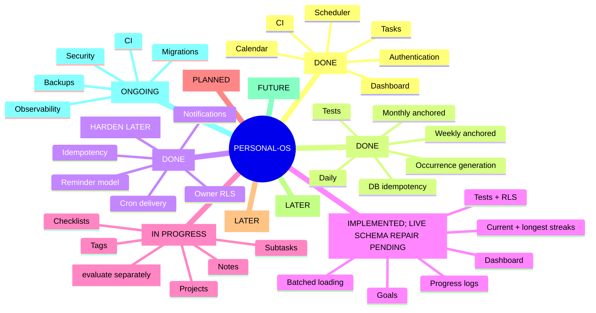

> **Verified checkpoint — 2026-11-21 (transactional task activity events).** Repository `mohith-krishnaa/personal-os`; branch `feature/organization-v1`; starting HEAD `431f311281bb432f2d722d671c9ad515ad27d275`; implementation commit `daf399d7f09feea92f30e8b0e3429916f1d55400`; test-type correction/final code HEAD `e288c55768bca52e906d51fd6b9580f3ba0cff33`. [CI #408](https://github.com/mohith-krishnaa/personal-os/actions/runs/44802872792) passed on that exact final code HEAD. PR #11 remains open, unmerged, non-draft, and mergeable; PR #12 remains an open superseded draft.
>
> Added branch-only migration `20261121000100_durable_task_activity_events.sql`. A SECURITY INVOKER `AFTER INSERT OR UPDATE` trigger writes `TASK_CREATED`, `TASK_UPDATED`, `TASK_COMPLETED`, `TASK_STATUS_CHANGED`, and `TASK_RECURRENCE_GENERATED` events inside the same PostgreSQL statement transaction. If the event insert fails, the task INSERT/UPDATE rolls back. No-op updates and recurring-root self-link initialization do not emit duplicate events. The existing recurrence unique index remains the occurrence idempotency guard.
>
> Removed the four application-side task activity-event inserts from `src/lib/tasks.ts`; the database trigger now covers task and subtask inserts, task updates/status changes, and recurrence occurrence inserts at the database boundary. Extracted `setTaskStatusForUser` so a repeated COMPLETED request retries a missing recurrence occurrence after a previous occurrence INSERT/event transaction rolled back. Existing reminder delivery remains on its separate atomic RPC.
>
> Added disposable-PostgreSQL fault-injection tests for TASK_CREATED, TASK_UPDATED, TASK_COMPLETED, and TASK_RECURRENCE_GENERATED failures. They verify rollback of the corresponding task statement, successful retry, no-op update behavior, recurrence uniqueness/source metadata, SECURITY INVOKER/search_path/EXECUTE grants, and Owner A/B event isolation. Added read-only preflight query 16 and updated the migration runner to expect 23 migrations and reapply the new migration.
>
> CI #407 initially failed TypeScript typecheck because the new status-test mock read an optional `error` property from a discriminated plan union. The test mock now checks property presence. CI #408 passed: PostgREST safety preflight **17/17**; PostgreSQL 17 migration replay **23/23**; task activity fault-injection/retry, migration reapplication, Organization/RLS, archive, hierarchy, and concurrency assertions passed; application tests **133/133**; TypeScript typecheck; production build; npm audit reported **0 vulnerabilities**. No lint script is configured.
>
> **Remaining consistency gaps:** task-create request idempotency is not implemented, so a client retry can still create a second task row and a second truthful TASK_CREATED event. DELETE events are not captured. `activity_events` remains owner-scoped but mutable (`FOR ALL` RLS), polymorphic without an entity FK, and not an immutable audit log. No historical event backfill was added. Analytics must not interpret event counts as user-intent counts or infer that a missing event means no task deletion.
>
> No production Supabase query or write was performed in this run. The last verified live baseline remains eight migration-ledger versions; the branch now has 23 migrations (15 branch-only if the live ledger is unchanged). This is not a fresh production confirmation. No production DDL/DML, migration, RLS change, backup, restore, or PR merge occurred. Owner-controlled complete schema/data/roles backup, successful isolated restore, restored-copy checklist conflict review, and authenticated two-owner PostgREST acceptance remain outstanding.
>
> The remote PR diff changed six files relative to the starting HEAD. No unrelated file or secret was introduced. No local checkout is attached, so local working-tree cleanliness cannot be certified.
>
> **Next action:** add stable client-generated request IDs for task and subtask creation, persist a per-owner unique request key, and test same-request retries plus concurrent duplicate submissions. Keep Analytics queued until create idempotency, delete-event semantics, and Organization's isolated production acceptance gates are resolved.
---

> **Verified checkpoint — 2026-11-20 (owner-scoped task update service coverage).** Starting PR head `0c9b9b979a53cdf78701f2f51c0f0d3c95f3f560`; code/test head `44ecc05f9b62a10175f9b7f608c1ff0636b1dbc3`; [CI #403](https://github.com/mohith-krishnaa/personal-os/actions/runs/44782848704) passed on the exact code/test head. PR #11 remains open, unmerged, and mergeable; PR #12 remains an open superseded draft.
>
> Extracted the authenticated update implementation into `updateTaskForUser(supabase, userId, id, input)`; the public `updateTask` entry point still creates the server Supabase client, resolves `auth.getUser()`, rejects unauthenticated callers, and delegates with the authenticated owner ID. Validation order and update behavior are preserved. No server action contract changed.
>
> Added seven direct service-path tests covering missing-owner rejection before database access; omitted relationship fields staying out of the patch; explicit `null` clearing only the named relationship; preserving the other relationship while changing a parent; owner-scoped current-row, parent/project preflight, and final UPDATE filters; requiring an ACTIVE owner project for a new assignment; rejecting an ARCHIVED project before any UPDATE or activity-event insert; and an explicit update-column allowlist that ignores spoofed `id`, `user_id`, `status`, `created_at`, and `recurrence_parent_id` input properties. The task application suite increased from 125 to **132 tests**.
>
> CI #403 passed: PostgREST safety preflight **17/17**; full PostgreSQL 17 replay of all **22/22** repository migrations plus Organization/RLS, archive, FK and hierarchy/concurrency assertions; application tests **132/132** with 0 failures; TypeScript typecheck; production build; npm install audited 43 packages with **0 vulnerabilities**. No lint script is configured.
>
> No migration, RLS policy, database trigger, production query/write, or production schema change was made. The branch diff from the starting head contains only `src/lib/tasks.ts` and `src/lib/tasks.test.ts`. The automation environment has no attached local checkout, so local working-tree cleanliness cannot be certified.
>
> The last recorded live Supabase baseline remains eight applied migration versions versus 22 in the branch, but it was not freshly queried in this run. Complete owner-controlled schema/data/roles backup, successful isolated restore, restored-copy checklist conflict review, and authenticated two-owner PostgREST acceptance remain outstanding. Do not start Analytics or alter production before those gates pass.
>
> **Next action:** audit `updateTask` failure semantics end-to-end—owner-scoped current-row lookup errors, final UPDATE errors, and the separate best-effort `TASK_UPDATED` activity insert. Establish the intended consistency contract before changing behavior; add focused tests only for a demonstrated defect.

---

> **Verified checkpoint — 2026-11-20 (runtime task/project relationship audit and authorization-error propagation).** Repository: `mohith-krishnaa/personal-os`; branch: `feature/organization-v1`; starting HEAD `eb8610888b21b4d158de068a7b33f2d7610b0c22`; code/test HEAD `065d114a2047ad0794618e5b43eb570c0f4c05cb`; [CI #400](https://github.com/mohith-krishnaa/personal-os/actions/runs/44773159878) passed on that exact code/test HEAD. PR #11 remains open and unmerged; PR #12 remains an open superseded draft.
>
> Audited the runtime project/task callers: `createTask` derives `user_id` from the authenticated user, validates owner-scoped parent/project links and requires ACTIVE for new project assignments; `updateTask` first reads the current task under `id + user_id`, resolves omitted versus explicit-null relationship fields, validates the resulting links, builds an explicit update allowlist, and constrains the UPDATE by both task ID and owner; subtask server actions authenticate before passing the owner ID to `createSubtask`, which verifies parent ownership, same-project consistency, and ACTIVE-project eligibility before inserting with that owner; `listSubtasks` verifies the parent and filters children by both owner and parent; project create/update paths derive or verify the authenticated owner and owner-scope mutations. The UI callers display caught `Error.message` values. The database triggers remain authoritative for direct PostgREST writes and race conditions.
>
> Found a real error-handling defect: task relationship preflight and subtask parent/project lookups converted **every** Supabase lookup error into “Parent task not found” or “Project not found.” This concealed SQLSTATE 42501 authorization failures and operational errors. Added `throwIfUnexpectedLookupError`: PostgREST `PGRST116` still becomes the owner-safe generic not-found result; SQLSTATE `42501` becomes a safe `Error` message (“You are not authorized to access the requested task or project.”) with the code retained; other PostgREST error objects are converted to `Error` instances with their message/code so client components do not fall back to generic “could not” text. Both task-link preflight and subtask create/list lookups use the helper.
>
> Added six regression tests across `src/lib/tasks.test.ts` and `src/lib/subtasks.test.ts` for parent/project authorization errors, error propagation through subtask create/list, and the PGRST116 owner-safe not-found case. No application API contract, migration, database function, trigger, or RLS policy changed; repository migration count remains 22.
>
> CI #398 and #399 failed because the newly inserted direct-self-parenting test header in `tasks.test.ts` was missing its opening block brace; the test file failed to parse at line 198, so typecheck/build were skipped. The syntax was corrected in commit `065d114a2047ad0794618e5b43eb570c0f4c05cb`. [CI #400](https://github.com/mohith-krishnaa/personal-os/actions/runs/44773159878) then passed on the corrected code/test HEAD: PostgREST safety preflight **17/17**; full PostgreSQL 17/22-migration replay and Organization/RLS assertions passed; hierarchy/concurrency checks passed; application tests **125/125**; TypeScript typecheck passed; production build passed; npm install audit reported **0 vulnerabilities**. No lint script is configured.
>
> This run did not inspect or mutate production Supabase. The last verified production checkpoint remains eight live migration-ledger entries versus 22 branch migrations; that state was not refreshed here. No production DDL/DML, migration, RLS change, backup, restore, or PR merge occurred. The complete owner-controlled schema/data/roles backup, successful isolated restore, restored-copy checklist conflict review, and authenticated two-owner PostgREST acceptance remain outstanding. Local working-tree cleanliness cannot be certified because no local checkout is attached; the remote diff from the starting HEAD contains only the four task/subtask source and test files.
>
> **Next action:** add focused unit coverage around the actual `updateTask` service path (owner-scoped current-row read, explicit-null versus omitted relationship patch, and owner-scoped UPDATE allowlist) without introducing a migration. If the owner-controlled backup is still unavailable, keep production read-only and do not start Analytics.

---

> **Verified checkpoint — 2026-11-20 (Organization migration dependency and FK-contract audit).** Repository: `mohith-krishnaa/personal-os`; branch: `feature/organization-v1`; code/test HEAD `b91e63bddb1decace36be78b3849dce02133fb9b`; [CI #396](https://github.com/mohith-krishnaa/personal-os/actions/runs/44762846651) passed on that exact HEAD. PR #11 remains open and unmerged; PR #12 remains an open superseded draft.

> Fresh read-only Supabase inspection: project `gujzvkyytxsnervovvrt` is ACTIVE_HEALTHY on PostgreSQL 17.11.0.003 in `ap-southeast-1`. The live migration ledger has exactly eight versions: 20260829182309, 20260830085036, 20260830103327, 20260830114218, 20260830120132, 20260830123420, 20260830141616, and 20260905162251. The branch contains 22 numbered SQL migrations, so 14 remain branch-only. All nine live public tables have RLS enabled and currently report zero rows.

> The live legacy schema matches the expected eight-version baseline: `projects.title/status` exist while `projects.name` is absent; `goals.unit/target` are absent; both checklist tables are absent; task/project/goal/reminder/notification FKs exist with the expected targets and delete actions; `notifications_reminder_unique` is a valid unique index on `notifications(reminder_id)`. The six baseline FKs inspected are validated, MATCH SIMPLE, NOT DEFERRABLE, and use ON UPDATE NO ACTION. The custom `auth.users.on_auth_user_created` trigger exists. `rls_auto_enable()` is SECURITY DEFINER with `search_path=pg_catalog`, and effective EXECUTE is denied to PUBLIC/anon/authenticated and granted to service_role. Installed extensions: pg_stat_statements 1.11, pgcrypto 1.3, supabase_vault 0.3.1, uuid-ossp 1.1.

> The 14 branch-only migrations were reviewed in timestamp order against those exact ledger versions and live catalog contracts. No missing prerequisite or dependency-order inversion was found. The migration replay script counts 22 files, replays them lexicographically, seeds legacy checklist fixtures after the legacy table is created and before reconciliation, and runs the read-only conflict report after replay.

> The audit found a fail-closed gap: the project/task FK guard and the reminder/notification migration verified ON DELETE and target columns but did not require the baseline ON UPDATE NO ACTION action when recognizing the old single-column FK. A noncanonical ON UPDATE CASCADE constraint could therefore be accepted as the expected legacy contract and then replaced with a different default action. The live baseline itself is canonical; this was a migration-guard weakness, not a detected live-schema mismatch.

> Corrected `20261119000300_ensure_project_task_foreign_keys.sql` and `20261120000200_enforce_reminder_notification_ownership.sql` to require ON UPDATE NO ACTION when matching the legacy contracts. Updated preflight query 11 to report and match the expected update action. Added rollback-only negative tests that install NOT VALID ON UPDATE CASCADE variants for project/task, reminder/task, and notification/reminder FKs and require the guards to fail closed. Migration count remains 22; no new migration was added.

> [CI #396](https://github.com/mohith-krishnaa/personal-os/actions/runs/44762846651) passed on code/test HEAD `b91e63bddb1decace36be78b3849dce02133fb9b`: acceptance preflight 17/17; PostgreSQL 17 migration replay 22/22; Organization/RLS, archive lifecycle, hierarchy/concurrency, and the new noncanonical ON UPDATE rejection cases passed; application tests 119/119; typecheck and production build passed; npm install audited 43 packages and reported 0 vulnerabilities. The workflow has no lint step. Expected SQL errors from the negative tests were matched by the runner and the step passed.

> No production DDL/DML, migration, RLS change, backup, restore, or PR merge occurred. The complete owner-controlled schema/data/roles backup, successful isolated restore, restored-copy checklist conflict review, and live two-owner PostgREST acceptance remain outstanding. The static audit and CI replay do not replace those owner gates.

> **Next action:** owner-controlled complete backup and isolated restore, then apply the 14 branch-only migrations only to that isolated target, review the checklist conflict report, and execute the authenticated two-owner PostgREST harness. If the owner action is still unavailable, do not retry production operations; continue with a static audit of runtime task/project create/update callers against the active-project and ownership triggers. Keep Analytics queued.

---

> **Verified checkpoint — 2026-11-20 (owner backup/restore and checklist reconciliation audit).** Repository: mohith-krishnaa/personal-os; branch: feature/organization-v1; inspected starting HEAD: 0632d89c17c67a66fea01d880f5de2b45748e8c3. CI #392 passed on that exact starting HEAD. PR #11 is open, unmerged, and its head matches the branch; PR #12 remains an open superseded draft. This run changes documentation only; the new documentation commit must receive its own CI result.
>
> Fresh read-only Supabase inspection: project gujzvkyytxsnervovvrt is ACTIVE_HEALTHY on PostgreSQL 17.11.0.003 in ap-southeast-1. The live migration ledger contains exactly eight versions (20260829182309, 20260830085036, 20260830103327, 20260830114218, 20260830120132, 20260830123420, 20260830141616, 20260905162251); the branch has 22 migrations, 14 pending relative to that ledger. No production DDL/DML, migration, RLS change, backup, restore, or merge occurred.
>
> Read-only source snapshot: all nine public application tables have zero rows; auth.users=0; storage.buckets=0; storage.objects=0; vault.secrets=0. auth.schema_migrations has 84 platform-managed rows and storage.migrations has 81; these are provider metadata, not application records to copy into a new project. Installed non-plpgsql extensions are pg_stat_statements 1.11, pgcrypto 1.3, supabase_vault 0.3.1, and uuid-ossp 1.1. There are no deployed Edge Functions and no RLS policies in auth/storage.
>
> The restore audit found one custom managed-schema object that the default Supabase CLI dump omits: auth.users.on_auth_user_created invokes public.handle_new_user(). The function is SECURITY INVOKER with search_path=public and inserts public.profiles. Its trigger DDL is in the already-applied baseline migration 20260829182309_create_personal_os_core.sql, so it must be explicitly restored/verified on the isolated copy; a schema diff against that same eight-migration baseline may not emit it. The other 11 non-internal auth/storage triggers are Storage platform triggers owned by supabase_storage_admin and must not be copied manually.
>
> The existing backup instructions were incomplete: they assumed supabase link from the repository despite no supabase/config.toml, did not preserve the supabase_migrations history separately, and did not call out the auth trigger, installed extensions, Vault root-key boundary, or Storage object bytes. The preflight and PostgREST runbooks now specify the exact artifact set, isolated restore sequence, evidence manifest, migration-history check, conflict report review, and harness gate.
>
> No backup was created. The automation container has no repository checkout, Docker, Supabase CLI, pg_dump, or psql; the connected Supabase tools expose read-only inspection but no backup-export action. The last recorded Dashboard check says the Free Plan has no scheduled backups; recheck billing at the time of the owner action. Analytics remains queued.
>
> **Next owner action:** from a private owner-controlled workstation, create roles/schema/data and migration-history exports; capture the custom auth.users trigger and any managed-schema customizations; record SHA-256 hashes and a source manifest; restore to a separate isolated Supabase project; verify extension versions, exact eight-version history, row counts, RLS/catalog contracts, and the auth trigger; then apply only the 14 branch-only migrations to that isolated target, run the checklist conflict report, and execute the two-owner PostgREST harness. Never use production for these tests.

---

> **Verified checkpoint — 2026-11-20 (isolated two-owner PostgREST acceptance harness and fail-fast CI preflight).** Repository: \`mohith-krishnaa/personal-os\`; branch: \`feature/organization-v1\`; code/CI commit \`be2b4657777522b8687e5bdad7f09482d166e49c\`; [CI #391](https://github.com/mohith-krishnaa/personal-os/actions/runs/44745594557) passed on that exact commit. The preceding implementation commit \`994b80e148932d195e40ecffbbe5ed75a56955ac\` passed [CI #389](https://github.com/mohith-krishnaa/personal-os/actions/runs/44745116701), and the documentation checkpoint \`f9abdc74213492e722587bc15f072e2cf75a7336\` passed [CI #390](https://github.com/mohith-krishnaa/personal-os/actions/runs/44745373172). PR #11 remains open and unmerged.

> Added \`scripts/postgrest-organization-acceptance.ts\`, its safety-gate tests, and the [isolated PostgREST acceptance runbook](docs/operations/organization-v1-postgrest-acceptance.md). The live harness uses two distinct password-authenticated sessions and only the isolated project's anon/publishable key; JWT service-role and \`sb_secret_\` keys are rejected. It verifies both owners' project/task/subtask CRUD, canonical \`checklist_items\` and legacy \`task_checklist_items\` CRUD, reciprocal cross-owner SELECT/INSERT/UPDATE/DELETE restrictions, cross-owner project/task/parent associations, and parent-delete cascades. Cleanup is limited to IDs returned by this run's inserts and proceeds child-first.

> The environment gate requires \`--execute\`, three explicit isolated-target/backup-restore attestations, a project ref matching the URL, two distinct test emails, and either a standard HTTPS Supabase project URL or the exact local loopback endpoint. The known production ref \`gujzvkyytxsnervovvrt\` is permanently blocked; custom domains, path/query URLs, conflicting \`NEXT_PUBLIC_SUPABASE_URL\`/\`SUPABASE_URL\`, and service/secret keys are refused. The confirmation variables are operator attestations, not proof of backup completeness or restore success.

> The first implementation CI #386 failed TypeScript typecheck because the default \`ReturnType<typeof createClient>\` inferred a \`never\` schema; migration replay, hierarchy concurrency, and 116/116 tests had passed. The fix explicitly instantiates the Supabase client generic, makes cleanup child-first, and uses \`pathToFileURL\` for cross-platform CLI detection. [CI #387](https://github.com/mohith-krishnaa/personal-os/actions/runs/44744569497) passed with 118/118 tests; [CI #388](https://github.com/mohith-krishnaa/personal-os/actions/runs/44744843739) passed on the documentation checkpoint; [CI #389](https://github.com/mohith-krishnaa/personal-os/actions/runs/44745116701) passed with symmetric subtask CRUD and secret-key-prefix coverage; [CI #390](https://github.com/mohith-krishnaa/personal-os/actions/runs/44745373172) passed on the next documentation checkpoint.

> Added \`npm run test:acceptance:preflight\` and a CI step that runs the **17 safety-gate tests before PostgreSQL client installation and migration replay**. The same tests remain in the full application suite. [CI #391](https://github.com/mohith-krishnaa/personal-os/actions/runs/44745594557) passed: preflight **17/17**; PostgreSQL 17 replay **22/22 migrations**; Organization/RLS, archive, hierarchy and concurrency assertions passed; full application tests **119/119**; TypeScript typecheck and production build passed; npm install audited 43 packages and reported **0 vulnerabilities**. No lint script is configured.

> No migration, schema, RLS policy, production data, or live Supabase endpoint was changed or queried in this harness-preparation run. Repository migration count remains **22**. The authenticated PostgREST harness has **not** been executed: no owner-verified complete schema/data/roles backup and isolated restore is available in this run, and no isolated test-user credentials were supplied. Unit tests exercise the safety gate only; they are not evidence of live PostgREST isolation.

> **Next owner action:** create a complete owner-controlled schema/data/roles backup; restore it into a separate isolated project; verify the restore and checklist reconciliation conflict report; create two disposable confirmed Auth users; then run the documented harness. Do not use production. Keep Analytics queued until Organization's production acceptance gates are genuinely satisfied.

> ---

> **Verified checkpoint — 2026-11-20 (isolated two-owner PostgREST acceptance harness prepared).** Repository: \`mohith-krishnaa/personal-os\`; branch: \`feature/organization-v1\`; final implementation/test commit \`994b80e148932d195e40ecffbbe5ed75a56955ac\`; [CI #389](https://github.com/mohith-krishnaa/personal-os/actions/runs/44745116701) passed on that exact commit. The preceding documentation checkpoint \`50f48930f7e5c355006c6cac2843ea93ce15733a\` also passed [CI #388](https://github.com/mohith-krishnaa/personal-os/actions/runs/44744843739). PR #11 remains open and unmerged.

> Added \`scripts/postgrest-organization-acceptance.ts\`, \`scripts/postgrest-organization-acceptance.test.ts\`, and the [isolated PostgREST acceptance runbook](docs/operations/organization-v1-postgrest-acceptance.md). The live harness uses two distinct password-authenticated sessions and only the isolated project's anon/publishable key; JWT service-role and \`sb_secret_\` keys are rejected. It verifies both owners' project/task/subtask CRUD, canonical \`checklist_items\` and legacy \`task_checklist_items\` CRUD, reciprocal cross-owner SELECT/INSERT/UPDATE/DELETE restrictions, cross-owner project/task/parent associations, and parent-delete cascades. Both owners' subtasks now have explicit read/update/delete coverage. Cleanup is restricted to IDs returned by this run's inserts and deletes child-first.

> The environment gate requires \`--execute\`, three explicit isolated-target/backup-restore attestations, a project ref matching the URL, two distinct test emails, and either a standard HTTPS Supabase project URL or the exact local loopback endpoint. The known production ref \`gujzvkyytxsnervovvrt\` is permanently blocked; custom domains, path/query URLs, conflicting \`NEXT_PUBLIC_SUPABASE_URL\`/\`SUPABASE_URL\`, and service/secret keys are refused. The confirmation variables are operator attestations, not proof of backup completeness or restore success.

> [CI #386](https://github.com/mohith-krishnaa/personal-os/actions/runs/44744300279) initially failed TypeScript typecheck because the default \`ReturnType<typeof createClient>\` inferred a \`never\` schema; migration replay, hierarchy concurrency, and 116/116 tests had passed. The fix explicitly instantiates the Supabase client generic, makes cleanup child-first, and uses \`pathToFileURL\` for cross-platform CLI detection. [CI #387](https://github.com/mohith-krishnaa/personal-os/actions/runs/44744569497) passed with 118/118 tests; [CI #388](https://github.com/mohith-krishnaa/personal-os/actions/runs/44744843739) passed on its documentation checkpoint; [CI #389](https://github.com/mohith-krishnaa/personal-os/actions/runs/44745116701) passed on the final implementation: PostgreSQL 17 replay **22/22 migrations**; Organization/RLS, archive, hierarchy and concurrency assertions passed; **119/119 application tests passed**; TypeScript typecheck and production build passed; npm install audited 43 packages and reported **0 vulnerabilities**. No lint script is configured.

> No migration, schema, RLS policy, production data, or live Supabase endpoint was changed or queried in this harness-preparation run. Repository migration count remains **22**. The authenticated PostgREST harness has **not** been executed: no owner-verified complete schema/data/roles backup and isolated restore is available in this run, and no isolated test-user credentials were supplied. Unit tests exercise the safety gate only; they are not evidence of live PostgREST isolation.

> **Next owner action:** create a complete owner-controlled schema/data/roles backup; restore it into a separate isolated project; verify the restore and checklist reconciliation conflict report; create two disposable confirmed Auth users; then run the documented harness. Do not use production. Keep Analytics queued until Organization's production acceptance gates are genuinely satisfied.

> ---

> **Verified checkpoint — 2026-11-20 (isolated two-owner PostgREST acceptance harness prepared).** Repository: \`mohith-krishnaa/personal-os\`; branch: \`feature/organization-v1\`; implementation commit \`278ba73b7efe5400f931c12197cc46c8c5f57093\` initially passed migration replay and 116 application tests but failed TypeScript typecheck because the Supabase client's default generic resolved its schema to \`never\`. Corrected in \`c9c24e2635d18336121f85cffb1ecfe9cccfc7d4\`; [CI #387](https://github.com/mohith-krishnaa/personal-os/actions/runs/44744569497) passed on that exact code/test commit. PR #11 remains open and unmerged.

> Added \`scripts/postgrest-organization-acceptance.ts\` and its preflight tests. The live harness uses two separate password-authenticated sessions and only the isolated project's anon/publishable key; JWT service-role keys and \`sb_secret_\` keys are rejected. It exercises project, task, subtask, canonical \`checklist_items\`, and legacy \`task_checklist_items\` CRUD; reciprocal cross-owner SELECT/INSERT/UPDATE/DELETE restrictions; cross-owner project/parent/task associations; and parent-delete checklist/task cascade behavior. Cleanup is limited to IDs returned by this run's inserts and proceeds child-first.

> The environment gate requires \`--execute\`, explicit isolated-target and restored-backup attestations, a matching project ref, two different test emails, and an HTTPS standard Supabase project URL (or the exact local loopback endpoint). The known production ref \`gujzvkyytxsnervovvrt\` is permanently blocked; custom domains and conflicting \`NEXT_PUBLIC_SUPABASE_URL\`/\`SUPABASE_URL\` values are refused. No service-role key is accepted or used. The confirmation variables are operator attestations, not proof of a backup or restore.

> [CI #386](https://github.com/mohith-krishnaa/personal-os/actions/runs/44744300279) exposed the initial type mismatch after migration replay, hierarchy concurrency, and 116/116 tests passed; typecheck failed and build was skipped. The fix instantiated the Supabase client generic explicitly, made cleanup child-first, and used \`pathToFileURL\` for cross-platform CLI detection. Two additional safety tests cover generic URL mismatch and path/query rejection. [CI #387](https://github.com/mohith-krishnaa/personal-os/actions/runs/44744569497) passed: PostgreSQL 17 replay **22/22 migrations**; Organization/RLS, archive, hierarchy and concurrency assertions passed; **118/118 application tests passed**; TypeScript typecheck and production build passed; npm install audited 43 packages and reported **0 vulnerabilities**. No lint script is configured.

> No migration, schema, RLS policy, production data, or live Supabase endpoint was changed or queried in this harness-preparation run. Repository migration count remains **22**. The authenticated PostgREST harness has **not** been executed: there is no owner-verified complete schema/data/roles backup and isolated restore available in this run, and no isolated test-user credentials were supplied. Unit tests only verify the preflight gate; they are not evidence of live PostgREST isolation.

> **Next owner action:** create a complete owner-controlled backup of schema, data, and roles; restore it into a separate isolated project; verify the restore and checklist reconciliation conflict report; create two disposable confirmed Auth users; then run the documented harness. Do not use production. Keep Analytics queued until Organization's production acceptance gates are genuinely satisfied.

> ---

> **Verified checkpoint — 2026-11-20 (reminder delivery route contract).** Repository: `mohith-krishnaa/personal-os`; branch: `feature/organization-v1`; code/test commit: `b49dfe13a175fee78bd20f7c34a5c651633ac812`; [CI #384](https://github.com/mohith-krishnaa/personal-os/actions/runs/44734936277) passed. PR #11 remains open and unmerged.
>
> Extracted the reminder delivery request logic into `src/lib/reminder-delivery-handler.ts`, with the route exporting the same handler for GET and POST. `getReminderWorkerSecret()` preserves the existing precedence (`REMINDER_WORKER_SECRET`, then `CRON_SECRET`). No deployed secret values were read or committed. The existing `vercel.json` cron still targets `/api/reminders/deliver` every five minutes.
>
> Added `src/lib/reminder-delivery-handler.test.ts` to `npm test`. Both GET and POST are tested for missing configuration, missing/wrong credentials, no admin-client creation before authorization, exactly one `claim_due_reminders({ p_limit: 100 })` RPC on success, response count mapping, empty claims, returned RPC errors, and rejected RPC promises. Thrown transport/client errors return a generic HTTP 500 without exposing the thrown detail or worker token.
>
> The first test attempt [CI #381](https://github.com/mohith-krishnaa/personal-os/actions/runs/44734618309) failed because the generated authorization regex contained a double-escaped whitespace token; corrected in `aae5007aa31b18b2e4ec84ee2efa42443c0dc49d`. [CI #382](https://github.com/mohith-krishnaa/personal-os/actions/runs/44734660774) then exposed a test-fixture bug: passing `undefined` activated the harness default secret, so the missing-secret case was not actually missing; corrected in `c391ac9bbeb4e206f1f5dd3f0ec62c929010b7a0`. [CI #383](https://github.com/mohith-krishnaa/personal-os/actions/runs/44734731617) passed migration replay and all 102 application tests but failed typecheck because `ProcessEnv` did not overlap with the narrow environment object type. The resolver now accepts `Record<string, string | undefined>`.
>
> [CI #384](https://github.com/mohith-krishnaa/personal-os/actions/runs/44734936277) passed on the exact code/test commit `b49dfe13a175fee78bd20f7c34a5c651633ac812`: PostgreSQL 17 replayed **22/22 migrations**; Organization/RLS, archive, task hierarchy, and concurrency checks passed; **102/102 application tests passed**; TypeScript typecheck and production build passed. npm install audited 43 packages and reported **0 vulnerabilities**; the existing install-script allowlist warning remains. No lint script is configured.
>
> No database migration, application schema, RLS policy, or production record changed in this task. Repository migration count remains **22**. No production Supabase operation was performed; the last verified live checkpoint remains 8 migration-ledger entries versus 22 in the branch, but live state was not rechecked during this route-only task. Production rollout remains blocked on a complete owner-controlled schema/data/roles backup, successful isolated restore, restored-copy checklist conflict review, and authenticated two-user PostgREST CRUD/isolation testing.
>
> **Next task:** prepare an isolated-environment authenticated two-user PostgREST acceptance harness and explicit environment preflight. It must refuse production project URLs, require an explicitly supplied isolated/restored target, test owner-scoped CRUD and cross-user denial, and never apply migrations or write to production. Keep Analytics queued.
>
> ---
>
> **Verified checkpoint — 2026-11-20 (atomic reminder delivery).** Repository: `mohith-krishnaa/personal-os`; branch: `feature/organization-v1`; code/test commit: `2953e1eb29955d2464b2e565e80b41ad16a85510`; [CI #378](https://github.com/mohith-krishnaa/personal-os/actions/runs/44727301882) passed. PR #11 remains open and unmerged.
>
> A fresh read-only Supabase inspection found project `gujzvkyytxsnervovvrt` ACTIVE_HEALTHY on PostgreSQL 17.11.0.003, with 8 live migration-ledger entries and 9 public tables with RLS enabled. The live `claim_due_reminders(integer)` is still the older SECURITY DEFINER function: it locks due reminders with `FOR UPDATE SKIP LOCKED`, marks them delivered, and inserts the activity event, but it does not create the notification. Its execution is granted to `service_role` only. No production write was attempted.
>
> The branch worker previously performed notification upsert, delivered-marker update, and activity-event insert as separate PostgREST requests. If the final event insert failed after the delivered marker committed, the next run excluded that reminder and could not repair the missing event. The existing SQL claim function was not called by the route and did not create notifications.
>
> Added local-only migration `20261120000300_atomic_reminder_delivery.sql`, which replaces the claim function without changing its signature. Each claimed reminder now creates or safely reuses its matching notification, inserts `REMINDER_DELIVERED`, and only then sets `delivered_at` inside the same RPC transaction. An existing notification is reused only when its owner and task match; its read state is preserved. Any notification/event/update failure aborts the RPC statement and rolls back all writes, leaving the reminder retryable. The function remains SECURITY DEFINER with `search_path = pg_catalog, public`; EXECUTE is revoked from PUBLIC/anon/authenticated and granted only to service_role.
>
> `src/app/api/reminders/deliver/route.ts` retains its existing bearer-secret check and now calls only `claim_due_reminders(p_limit => 100)`; it no longer makes separate notification, reminder, and activity-event writes. The repository's `vercel.json` schedules this endpoint every five minutes; deployed secret configuration was not inspected.
>
> Added disposable-PostgreSQL fault-injection assertions for notification-insert and activity-event-insert failures, proving all writes roll back and retries succeed. Tests also verify an existing notification is reused without clearing `read_at`, repeated delivery produces no duplicate event/notification, and the RPC remains service_role-only. A separate two-session test proves Worker B completes with zero claims while Worker A holds the row lock, then exactly one notification, event, and delivered marker exist after Worker A commits. The migration is reapplied in CI to verify idempotence. Read-only preflight query 15 reports the function/security/locking contract.
>
> [CI #378](https://github.com/mohith-krishnaa/personal-os/actions/runs/44727301882) passed on the exact code/test commit: PostgreSQL 17 replayed **22/22 migrations**; the new migration reapplication, injected notification/event failure rollback and retry cases, existing-notification reuse, duplicate-call idempotency, two-session `SKIP LOCKED` concurrency, Organization/RLS, archive lifecycle, and hierarchy/project concurrency checks passed; **90/90 application tests passed**; TypeScript typecheck and production build passed. npm install audited 43 packages and reported **0 vulnerabilities**; the existing `esbuild@0.28.2` install-script allowlist warning remains. No lint script is configured.
>
> Repository migration count is **22**: 8 versions match the live ledger and 14 are branch-only (11 Organization/related, 1 Progress compatibility, 2 RLS performance). The new migration and route change are not deployed. No production DDL/DML, migration, RLS change, backup, restore, or PR merge occurred. Production rollout still requires a complete owner-controlled schema/data/roles backup, successful isolated restore, restored-copy checklist conflict review, and authenticated two-user PostgREST CRUD/isolation.
>
> **Next task:** add route-level tests for the reminder endpoint's bearer-secret rejection, successful RPC result mapping, and RPC error handling; verify the cron route/secret contract without reading or exposing secret values. Keep Analytics queued until Organization acceptance is genuinely complete.
>
> ---
>
> **Verified checkpoint — 2026-11-20 (reminder/notification owner-link integrity).** Repository: `mohith-krishnaa/personal-os`; branch: `feature/organization-v1`; code/test commit: `8fbf83e18fa15dc60a9a8bc8ab58563738d00df0`; PR #11 remains open and unmerged.
>
> Fresh read-only Supabase inspection confirms project `gujzvkyytxsnervovvrt` is ACTIVE_HEALTHY on PostgreSQL 17.11.0.003, with 8 live migration-ledger entries and 9 public tables with RLS enabled. Live `reminders_owner_insert/update` and `notifications_owner_update` policies check `auth.uid() = user_id` only. Live `reminders.task_id`, `notifications.reminder_id`, and `notifications.task_id` are single-column foreign keys. These contracts admit cross-owner reminder/task and notification/reminder/task associations through direct authenticated SQL/PostgREST if a caller supplies its own `user_id` with another owner's existing UUID. No production write was attempted.
>
> Added local-only migration `20261120000200_enforce_reminder_notification_ownership.sql`. It fails closed if existing rows contain mismatched owners or reminder/task pairs, adds the supporting unique keys `tasks(id,user_id)` and `reminders(id,user_id,task_id)`, and replaces the weak single-column reminder/task and notification/reminder foreign keys with composite owner-aware keys. Existing `ON DELETE CASCADE` behavior is preserved; the notification's task must match its reminder's task, and a reminder task cannot be changed while a notification references it. RLS policies and application runtime code were not changed.
>
> Extended `supabase/tests/organization-migration-assertions.sql` for Owner A and Owner B under `SET ROLE authenticated`: same-owner reminder INSERT and task reassignment succeed; cross-owner reminder INSERT/UPDATE fails; same-owner notification pair reassignment and read-state updates succeed; cross-owner task/reminder references and mismatched same-owner pairs fail without changing prior links. A `service_role` fixture verifies valid worker inserts still succeed while BYPASSRLS does not bypass the composite constraints. The migration runner now expects **21 migrations**, reapplies the migration to verify idempotence, and proves unexpected additional foreign keys fail closed. Read-only preflight queries 13–14 report the new FK and supporting unique-key contracts.
>
> [CI #375](https://github.com/mohith-krishnaa/personal-os/actions/runs/44719688076) passed on the exact code/test commit: PostgreSQL 17 replayed **21/21 migrations**; authenticated Owner A/B reminder/notification ownership assertions, service-role integrity assertions, migration reapplication, unexpected-FK negative tests, Organization/RLS, archive lifecycle, and hierarchy/project concurrency checks passed; **90/90 application tests passed**; TypeScript typecheck and production build passed. npm install reported **0 vulnerabilities**. No lint script is configured.
>
> The first code/test attempt `0336eef34d4dfffd7bc498d896aadfbc1af31128` failed CI #374 because Owner A's negative notification UPDATE reused Owner B's reminder that already had a notification; the pre-existing `notifications_reminder_unique` index correctly rejected the duplicate before the new composite FK was evaluated. The test fixture was corrected by adding unused foreign-owner reminder IDs (`810...005` and `810...006`) and targeting those IDs, so the regression now isolates the composite owner FK. No production data was involved. Corrected code/test commit `8fbf83e18fa15dc60a9a8bc8ab58563738d00df0` passed CI #375. Documentation checkpoint `4329dc2c88a528d2caaacba88ddd5dafaf34866d` passed CI #376 on the exact documentation HEAD.
>
> The live project remains at 8 migrations versus 21 in the branch (13 branch-only: 10 Organization/related, 1 Progress compatibility, 2 RLS performance). The new migration has not been applied to production. No production DDL/DML, migration, RLS change, backup, restore, or PR merge occurred. The live schema/policy evidence is read-only; the disposable PostgreSQL authenticated-role tests are not a live PostgREST test.
>
> **Next task:** audit the reminder delivery worker's service-role notification upsert and retry/claim behavior against the new composite FK contract; keep the valid worker path covered and verify duplicate delivery remains idempotent. Production rollout remains blocked on a complete owner-controlled schema/data/roles backup, successful isolated restore, restored-copy checklist conflict review, and authenticated two-user PostgREST CRUD/isolation.

> ---
>
> **Verified checkpoint — 2026-11-20 (authenticated hierarchy-cycle rejection on UPDATE).** Repository: `mohith-krishnaa/personal-os`; branch: `feature/organization-v1`; corrected code/test commit: `2af3b4615241c28fbbad8f10f7458bbe1aa76b5b`; PR #11 remains open and unmerged.
>
> Extended `supabase/tests/organization-migration-assertions.sql` with authenticated-role cycle tests for both owners. Owner A creates a three-level same-project chain, attempts to reparent its root beneath the descendant, requires the exact `Task hierarchy cannot contain cycles.` check violation, and verifies the original root NULL parent plus both existing descendant links remain unchanged. Owner B repeats the same attack inside its own project and verifies its root/child links remain intact. The tests run under `SET ROLE authenticated` with each owner's JWT subject and RLS enabled; no superuser bypass is used.
>
> The first test commit `041f56b8e04786b5f9dd9065edc512a05f3afa30` failed CI #367 because the Owner B PL/pgSQL block used `error_message` without declaring it. The workflow log identified the exact error (`"error_message" is not a known variable`). Corrected in `2af3b4615241c28fbbad8f10f7458bbe1aa76b5b` by declaring the diagnostic variable in Owner B's block. [CI #368](https://github.com/mohith-krishnaa/personal-os/actions/runs/44701628837) passed on the corrected commit: all **20/20 migrations** replayed in PostgreSQL 17; Organization/RLS and authenticated Owner A/B assertions passed; project archive lifecycle, hierarchy and two-session concurrency checks passed; **90/90 application tests passed**; TypeScript typecheck and production build passed. npm install reported **0 vulnerabilities**; the existing esbuild install-script allowlist warning remains. No lint script is configured.
>
> No migration, runtime application code, RLS policy, or production record changed; repository migration count remains 20. Production Supabase was not accessed during this test-only run. The last verified read-only production checkpoint remains 8 live migration-ledger entries versus 20 repository migrations; complete owner-controlled schema/data/roles backup and isolated restore, restored-copy checklist conflict review, and authenticated two-user PostgREST CRUD/isolation remain mandatory rollout gates. No production DDL/DML, migration, RLS change, backup, restore, or PR merge occurred.
>
> **Next task:** audit authenticated task deletion/cascade semantics. Inspect every task-delete caller and the `tasks.parent_task_id ON DELETE CASCADE` contract first; verify that deleting an owned parent removes only its intended descendant chain, unrelated tasks remain, and cross-owner deletes remain blocked by RLS. Do not change deletion behavior unless a concrete mismatch is found. Keep Analytics queued until Organization production acceptance is genuinely complete.
>
> ---
>
> **Verified checkpoint — 2026-11-20 (authenticated parent-task reassignment).** Repository: `mohith-krishnaa/personal-os`; branch: `feature/organization-v1`; code/test commit: `0a4bd7e623cee437580d425d0fb71e5758febb47`; PR #11 remains open and unmerged.
>
> Extended `supabase/tests/organization-migration-assertions.sql` to exercise `parent_task_id` UPDATEs under the actual disposable-database `authenticated` role with RLS enabled. Owner A can reparent a task to another parent in the same owned project; a parent from another project owned by A is rejected with the exact same-project check violation; a parent hidden by RLS because it belongs to Owner B is rejected with insufficient privilege. Both rejected updates must preserve the original parent link. After Owner A's project is archived, the existing task can still be reparented within that historical project without changing its project link. The reciprocal Owner B cross-owner attempt also verifies its previous NULL parent remains unchanged.
>
> [CI #364](https://github.com/mohith-krishnaa/personal-os/actions/runs/44694065363) passed on the exact code/test commit. The workflow replayed all **20/20 repository migrations** in disposable PostgreSQL 17; Organization/RLS, authenticated Owner A/B and anonymous denial assertions passed; project archive lifecycle, task hierarchy and two-session concurrency checks passed; **90/90 application tests passed**; TypeScript typecheck and production build passed; npm install reported **0 vulnerabilities**. The configured workflow has no separate `npm audit` step, and no lint script is configured.
>
> No migration, application runtime code, RLS policy, or production record changed; the repository remains at 20 migration files. Fresh read-only Supabase inspection found the project ACTIVE_HEALTHY on PostgreSQL 17.11.0.003 with **8 live migration-ledger entries** and 9 public application tables with RLS enabled. Live `projects.title/status` and `tasks.project_id/parent_task_id` exist; `projects.name` and user-defined triggers on `projects`/`tasks` remain absent. These tests run on disposable PostgreSQL and are not live PostgREST verification. No production DDL/DML, migration, RLS change, backup, restore, or PR merge occurred.
>
> **Next task:** add authenticated-role UPDATE coverage for hierarchy-cycle rejection: attempt to reparent a parent beneath its descendant, require the exact cycle check violation, and verify the prior parent relationship remains unchanged. Keep Analytics queued until Organization production acceptance is genuinely complete.
>
> ---

> **Verified checkpoint — 2026-11-20 (authenticated task project reassignment).** Repository: `mohith-krishnaa/personal-os`; branch: `feature/organization-v1`; code/test commit: `0da6239761d1f2fc1adf9b34d2a418517f9ae458`; PR #11 remains open and unmerged.
>
> Extended `supabase/tests/organization-migration-assertions.sql` so task project assignment and reassignment run under the actual disposable-database `authenticated` role with Owner A's JWT subject and RLS enabled. The fixture creates a second ACTIVE project owned by Owner A and exercises: an unassigned task assigned to an ACTIVE project; reassignment from one owned ACTIVE project to another; rejection of reassignment into a COMPLETED project; rejection of reassignment into an ARCHIVED project; and rejection of reassignment to Owner B's project. Rejected updates must leave the original `project_id` unchanged. The existing authenticated same-link update after archive remains covered, as do cross-owner parent INSERT denials.
>
> [CI #360](https://github.com/mohith-krishnaa/personal-os/actions/runs/44687024395) passed on the exact code/test commit. The workflow replayed all **20/20 migrations** in disposable PostgreSQL 17; Organization/RLS and authenticated/anonymous isolation assertions passed; project archive lifecycle and two-session task hierarchy/project-status concurrency checks passed; **90/90 application tests passed**; TypeScript typecheck passed; and the production build passed. The configured workflow does not run `npm audit`; no lint script is configured. No migration or runtime application code changed, and the repository remains at 20 migration files.
>
> Production Supabase was not accessed or modified during this test-only run. The last documented read-only checkpoint remains 8 live migration-ledger entries with the Organization trigger not deployed; that is not a fresh inspection for this run. No production DDL/DML, migration, RLS change, backup, restore, or PR merge occurred. No local checkout is attached, so local `git status` cannot be certified.
>
> **Next task:** add authenticated-role UPDATE coverage for `parent_task_id` changes: same-owner/same-project parent reassignment should succeed where valid; cross-owner and cross-project parent reassignment must fail without changing the prior relationship; existing historical tasks in completed/archived projects must remain maintainable without weakening the task-link guard. Keep Analytics queued until Organization acceptance is genuinely complete.
> ---
>
> **Verified checkpoint — 2026-11-20 (authenticated-role subtask enforcement).** Repository: `mohith-krishnaa/personal-os`; branch: `feature/organization-v1`; code/test HEAD: `eb194521e6d1bb12147058530c84ce7315395a44`; PR #11 remains open and unmerged.
>
> Extended `supabase/tests/organization-migration-assertions.sql` so the task-link checks execute under the actual disposable-database `authenticated` role with Owner A/Owner B JWT subjects. The fixture explicitly verifies `current_user = authenticated` and that the role is neither superuser nor `BYPASSRLS`. Owner A can create a subtask in its ACTIVE project with the correct parent/project links; after the project is changed to COMPLETED or ARCHIVED, equivalent subtask INSERTs fail with the exact active-project check violation and leave no rows. An unchanged historical project link remains valid for authenticated updates after archive. Cross-owner parent attempts are rejected in both directions, and Owner B's existing cross-owner project-link attempt remains rejected.
>
> [CI #357](https://github.com/mohith-krishnaa/personal-os/actions/runs/44680309313) passed on the exact code/test HEAD: **20/20 migrations replayed** in disposable PostgreSQL 17; Organization/RLS, authenticated isolation and anonymous denial assertions passed; project archive lifecycle and both two-session concurrency checks passed; **90/90 application tests passed**; TypeScript typecheck and production build passed. npm install audited 43 packages and found 0 vulnerabilities. The existing esbuild install-script allowlist warning remains; no security settings were changed. No lint script is configured. Next.js reported its normal tsconfig auto-adjustment during the ephemeral CI build; no local checkout is attached to verify any local working-tree state.
>
> No migration was added or modified; the repository remains at 20 migrations. Fresh read-only Supabase inspection: project `gujzvkyytxsnervovvrt` is ACTIVE_HEALTHY on PostgreSQL 17.11.0.003 with 8 applied migration versions; all 9 public tables have RLS enabled. Live `projects` retains legacy `title/status`, live `tasks` has `project_id/parent_task_id`, and no user-defined triggers are present on live `projects` or `tasks`. The branch-only active-project trigger is not deployed. These authenticated-role assertions run against the disposable PostgreSQL fixture; they are not a live PostgREST/API test.
>
> Production remains read-only. No production DDL/DML, migration, RLS change, backup, restore, or PR merge occurred. Owner-controlled complete schema/data/roles backup and successful isolated restore, restored-copy checklist conflict review, and authenticated two-user PostgREST CRUD/isolation remain rollout gates. No local checkout is attached, so local `git status` cannot be certified.
>
> **Next task:** add authenticated-role UPDATE/reassignment coverage for the active-project guard: assignment to ACTIVE succeeds; reassignment into COMPLETED/ARCHIVED is rejected; same-link historical updates remain valid; cross-owner reassignment stays blocked. Keep Analytics queued until Organization acceptance is genuinely complete.
> ---

> **Verified checkpoint — 2026-11-20 (direct PostgreSQL subtask lifecycle regression).** Repository: `mohith-krishnaa/personal-os`; branch: `feature/organization-v1`; code/test commit: `91075f588cd42f88b7014bb7e8d9eab8a32e3ab6`; PR #11 remains open and unmerged.
>
> Extended `supabase/tests/project-archive-lifecycle.sql` to exercise direct database subtask INSERTs that bypass application preflight. A subtask under an ACTIVE project succeeds with its exact `project_id` and `parent_task_id`; equivalent direct INSERTs under COMPLETED and ARCHIVED projects fail with the trigger's exact check-violation message, and the rejected task IDs do not persist. The fixture also asserts that an existing child remains linked to its archived project and parent after archive. Existing foreign-owner, cross-project-parent, and hierarchy-cycle checks remain in `organization-task-hierarchy.sql` and the concurrency runner.
>
> The existing `organization-migrations.sh` already runs this lifecycle fixture after replaying the full migration chain, so no workflow or migration-count fixture change was required. The chain remains at 20 migration files; no migration or application runtime code changed.
>
> [CI #354](https://github.com/mohith-krishnaa/personal-os/actions/runs/44673853542) passed on the exact code/test commit: all 20 PostgreSQL 17 migrations replayed; Organization migration/RLS and authenticated/anonymous isolation assertions passed; direct project/task archive lifecycle assertions passed; task hierarchy and concurrency checks passed; **90/90 application tests passed**; TypeScript typecheck and production build passed; npm audit reported 0 vulnerabilities. npm emitted the existing esbuild install-script allowlist warning; no install security setting was changed. No lint script is configured.
>
> Fresh read-only Supabase inspection: project `gujzvkyytxsnervovvrt` is ACTIVE_HEALTHY on PostgreSQL 17.11.0.003 with 8 applied migration versions. Live `projects` retains legacy `title/status`; `tasks.project_id` and `tasks.parent_task_id` exist; RLS is enabled on both tables; no user-defined triggers are present on live `projects` or `tasks`. The active-project trigger remains branch-only and has not been deployed.
>
> No production DDL/DML, migration, RLS change, backup, restore, or PR merge occurred. Owner-controlled complete schema/data/roles backup, successful isolated restore, restored-copy checklist conflict review, and authenticated two-user PostgREST CRUD/isolation remain rollout gates. No local checkout is attached, so local working-tree cleanliness cannot be certified.
>
> **Next task:** extend the authenticated two-owner migration fixture to exercise direct subtask INSERTs through the `authenticated` role: an ACTIVE-project subtask should succeed, while COMPLETED/ARCHIVED project links should fail through the SECURITY INVOKER trigger. Retain existing foreign-owner and parent/project relationship denial checks. Keep Analytics queued until Organization acceptance is genuinely complete.
> ---

> **Verified checkpoint — 2026-11-20 (two-session project archive/task-assignment serialization).** Repository: `mohith-krishnaa/personal-os`; branch: `feature/organization-v1`; code/test HEAD: `c016f78410eac0ddcfd521be19890853bd5268b2` (388 commits ahead of `main`, 0 behind at this code checkpoint). PR #11 remains open, unmerged, and mergeable.
>
> The previous archive-lifecycle checkpoint left one explicit gap: the `FOR SHARE` lock in `require_active_project_for_new_task_links` had only sequential coverage. Extended the disposable task-hierarchy fixture with a project status column and included the branch-only active-project migration, then added two-session READ COMMITTED races to `organization-task-hierarchy-concurrency.sh`. The test observes the actual blocker with `pg_blocking_pids`, verifies final rows, and checks that both sessions terminate.
>
> **Assignment-first:** task assignment acquires the project row's `FOR SHARE` lock; a concurrent ARCHIVED status update is observed waiting for that transaction. After assignment commits, archive commits and the existing task/project link remains intact. **Completion-first:** the project status update commits while holding the row lock; a concurrent task assignment waits, then is rejected with the dedicated check-violation message, leaving the task unassigned. The existing concurrent hierarchy-cycle test remains in the same CI step.
>
> CI #346 failed in the new test harness because `psql -c` sends SQL directly and does not expand psql's `:'variable'` syntax; logs showed a syntax error at the colon and the probe timed out before reaching its sleep. The correction in `c016f78410eac0ddcfd521be19890853bd5268b2` uses fixed test-owned application-name literals in those read-only polling queries. [CI #347](https://github.com/mohith-krishnaa/personal-os/actions/runs/44659601808) passed on that exact code/test HEAD: all 20 PostgreSQL 17 migrations replayed; Organization/RLS and project archive lifecycle assertions passed; both project/task lock-order races and the existing hierarchy-cycle concurrency check passed; **87/87 application tests passed**; TypeScript typecheck and production build passed. No lint script is configured.
>
> No migration was added or modified; the repository remains at 20 migration files. Fresh read-only Supabase inspection confirms project `gujzvkyytxsnervovvrt` is ACTIVE_HEALTHY on PostgreSQL 17.11.0.003, the live ledger still contains exactly 8 migrations, legacy `projects.title/status` and `tasks.project_id/parent_task_id` exist, `projects.name` is absent, and no user-defined triggers are present on the live `projects` or `tasks` tables. The new trigger and concurrency behavior are branch/CI-only and have not been applied to production.
>
> No production DDL/DML, migration, RLS change, backup, restore, or PR merge occurred. The owner-controlled complete schema/data/roles backup, successful isolated restore, restored-copy checklist conflict review, and authenticated two-user PostgREST CRUD/isolation remain rollout gates. No local checkout is attached, so local `git status` is unverified.
>
> **Next task:** audit every runtime task INSERT/creation path (including recurring generation and subtasks) to confirm it either uses the ACTIVE-project service preflight or remains protected by the database trigger, with owner filters preserved. Do not start Analytics until Organization acceptance is genuinely complete.
>
> ---

> **Verified checkpoint — 2026-11-20 (legacy COMPLETED project status compatibility).** Repository: `mohith-krishnaa/personal-os`; branch: `feature/organization-v1`; code/test commit: `7a4ec295972c0d64ff8f44a280563130ed375d40` (379 commits ahead of `main`, 0 behind). PR #11 remains open, unmerged, and non-draft.
>
> The legacy core schema permits project statuses `ACTIVE`, `COMPLETED`, and `ARCHIVED`, while the TypeScript `ProjectStatus` contract previously omitted `COMPLETED`. The project manager also rendered only active projects, hiding valid legacy completed projects. The type now represents all three persisted states; `ProjectStatusUpdate` intentionally excludes `COMPLETED`, so this compatibility fix does not introduce a new completion transition. The project manager displays completed projects in a separate section; rows are not editable, but each offers an explicit Archive action. The task-creation selector remains ACTIVE-only; existing task labels still resolve because the dashboard retains the full owner-scoped project list.
>
> Added regression coverage for active/completed/archive grouping, filtering and preserving a completed row without rewriting its status, and rejecting an application transition into `COMPLETED`. Changed exactly four code/test files: `src/types/project.ts`, `src/lib/projects.ts`, `src/lib/projects.test.ts`, and `src/app/dashboard/project-manager.tsx`. No migration, RLS policy, schema, or package script changed; the migration chain remains 19 files.
>
> [CI #338](https://github.com/mohith-krishnaa/personal-os/actions/runs/44644299182) passed on exact code/test HEAD `7a4ec295972c0d64ff8f44a280563130ed375d40`: all 19 PostgreSQL 17 migrations replayed; Organization/RLS assertions and task-hierarchy concurrency passed; **78/78 application tests passed**; TypeScript typecheck and production build passed. No lint script is configured.
>
> No local checkout is attached, so local `git status` cannot be certified. Production Supabase was not rechecked or changed in this application-only run; the last documented live ledger remains at 8 migrations. The complete owner-controlled schema/data/roles backup, successful isolated restore, restored-copy checklist conflict review, and authenticated two-user PostgREST CRUD/isolation gates remain outstanding. No production DDL/DML, migration, RLS change, backup/restore, or PR merge occurred.
>
> **Next task:** continue the Organization audit with a focused review of project archive lifecycle and task-link compatibility. Preserve completed/archived semantics and existing owner filters; do not add a migration without a demonstrated schema defect.
>
> ---

> **Verified checkpoint — 2026-11-20 (project name/title compatibility audit).** Repository: `mohith-krishnaa/personal-os`; branch: `feature/organization-v1`; code/test HEAD: `7cb91b4871038d866af439117ed0584af9d0e17f` (374 commits ahead of `main`, 0 behind). PR #11 is open, unmerged, non-draft, and mergeable; PR #12 remains a superseded open draft.
>
> Audited `src/lib/projects.ts`, project actions, `project-manager.tsx`, `task-editor.tsx`, dashboard task labels, the legacy core projects schema, `20260905170000_organization_v1.sql`, and `20261016000100_projects_name_title_compatibility.sql`. Current application reads and writes use canonical `projects.name`; project creation/rename derive the owner from the authenticated session, and task/project UI labels use the canonical name. No runtime `title` fallback is needed in current app code. The compatibility trigger retains the legacy `title` column for older clients and synchronizes both directions.
>
> The trigger's same-statement conflict rule was implicit but untested. Added SQL assertions that conflicting dual-column INSERT and UPDATE statements deterministically prefer canonical `name`, plus application-service assertions that create/rename payloads do not send legacy `title`. The exact net code diff from the prior head changes only `supabase/tests/organization-migration-assertions.sql` and `src/lib/projects.test.ts`. No runtime source, migration, RLS policy, or package script changed; migration count remains 19.
>
> [CI #335](https://github.com/mohith-krishnaa/personal-os/actions/runs/44636928070) passed on exact code/test HEAD `7cb91b4871038d866af439117ed0584af9d0e17f`: all 19 PostgreSQL 17 migrations replayed; Organization/RLS and project name/title assertions passed; task hierarchy concurrency passed; **75/75 application tests passed**; TypeScript typecheck passed; production build passed; npm audit found 0 vulnerabilities. npm emitted the existing install-script allowlist warning for `esbuild@0.28.2`; no security setting was changed. No lint script is configured.
>
> No local repository checkout is attached, so local `git status` cannot be certified. Production Supabase was not rechecked or changed during this application/test-only run. The last verified live checkpoint remains 8 applied migrations versus 19 in the repository; the complete owner-controlled schema/data/roles backup, successful isolated restore, restored-copy checklist conflict review, and authenticated two-user PostgREST CRUD/isolation gates remain outstanding. No production DDL/DML, migration, RLS change, backup/restore, or PR merge was performed.
>
> **Next task:** audit the legacy `projects.status = 'COMPLETED'` contract against `ProjectStatus`, project-manager visibility, and task-editor selection. Do not change the schema or broaden this task without a concrete compatibility defect and tests.
>
> ---
>
> **Verified checkpoint — 2026-11-20 (legacy-goal dashboard presentation).** Repository: `mohith-krishnaa/personal-os`; branch: `feature/organization-v1`; code/test head: `beedd5778a45d5ea72cf46a8675ed4bfd35099f6` (368 commits ahead of `main`, 0 behind). PR #11 remains open, unmerged, non-draft, and mergeable.
>
> The dashboard previously displayed `0%` and an empty progress bar for legacy goals with NULL/invalid measurement metadata. That was misleading: zero is not a measured percentage when no valid target/unit exists. Added `getGoalProgressPresentation` and wired the Goals & Streaks card to distinguish measurable from historical goals. Measurable goals retain total/target/unit, percentage, accessible progress bar, and progress form. Historical goals retain their summed total and streaks; the total includes a known unit when available or explicitly says the unit is unavailable. Missing target/unit details are identified, and no percentage, progress bar, or progress-entry form is rendered.
>
> Added four presentation regression cases: both metrics missing; target missing while a unit remains known; unit unavailable while a target exists; and valid measurable metrics. The net code diff from the prior checkpoint changes exactly three files: `src/lib/progress.ts`, `src/lib/progress.test.ts`, and `src/app/dashboard/page.tsx`. No migration, RLS policy, package script, or production database changed; the migration chain remains 19.
>
> CI #331 on intermediate code commit `a45440022cc14d15f83d77945cf2fb6580855c25` ran the full 19-migration PostgreSQL 17 replay, hierarchy checks, and **75/75 application tests successfully**, but typecheck failed with TS18047 because TypeScript did not narrow nullable `goal.unit` through the boolean helper. The unit is now normalized into a local string before formatting. [CI #332](https://github.com/mohith-krishnaa/personal-os/actions/runs/44628264813) passed on exact code/test head `beedd5778a45d5ea72cf46a8675ed4bfd35099f6`: migration replay, hierarchy checks, **75/75 tests**, typecheck, and production build all succeeded. npm audit reported 0 vulnerabilities. No lint script is configured.
>
> No local repository checkout is attached, so local `git status` cannot be certified. Production Supabase was not accessed or changed during this UI-only run. The previously documented owner-controlled schema/data/roles backup, successful isolated restore, restored-copy checklist conflict review, and authenticated two-user PostgREST CRUD/isolation gates remain outstanding. No production migration, DDL/DML, RLS change, backup/restore, or PR merge was performed.
>
> **Next task:** continue Organization V1 with a read-only audit of the legacy project `title` / canonical `name` compatibility path across project service, project manager, and task editor. Do not change production or start Analytics until Organization acceptance gates are satisfied.
>
> ---
>
> **Verified checkpoint — 2026-11-20 (legacy goal progress aggregation).** Repository: `mohith-krishnaa/personal-os`; branch: `feature/organization-v1`; code/test HEAD: `c9329a95b770b55168e85d349b1bd2fbde3e8bd8` (362 commits ahead of `main`, 0 behind). PR #11 is open, unmerged, non-draft, and GitHub reports it mergeable.
>
> Continued the documented Progress compatibility audit. `getGoalsWithProgress` already retained goals whose legacy `unit` and `target` are NULL, but had no direct regression coverage. Added five service tests proving that legacy goals remain in the result, their historical entries are grouped only under their own goal while preserving query order, totals and streaks remain available without fabricating a target/unit, measurable-goal percentages remain correct, empty-goal results skip the entries query, and both goals-query and progress-entry-query errors propagate. The grouping loop now appends to existing arrays rather than repeatedly copying them, keeping aggregation linear in the number of returned entries.
>
> The initial code/test commit `f98b63080aef9a3316119be736c9e078660ec080` failed CI #326 because the copied date-validation regular expression was over-escaped. The failure was inspected in the job logs and corrected in `c9329a95b770b55168e85d349b1bd2fbde3e8bd8`. [CI #327](https://github.com/mohith-krishnaa/personal-os/actions/runs/44617741781) passed on that exact corrected HEAD: PostgreSQL 17 replay of all 19 migrations, Organization/RLS assertions, task hierarchy checks, **71/71 application tests**, TypeScript typecheck, and production build. No lint script is configured.
>
> The code/test change touches only `src/lib/progress-service.ts` and `src/lib/progress-service.test.ts`. No migration, application UI, RLS policy, or production database was changed; migration count remains 19. No local checkout is attached, so local `git status` cannot be certified. Production was not rechecked during this application-only run; the last known backup/isolated-restore and authenticated two-user PostgREST gates remain outstanding.
>
> Personal-OS Builder is enabled. The automation record at recovery showed last run `9ba7d5ee-a1fc-8327-a46e-c10062739613` marked `in_progress` (started `2026-11-19T21:18:02.738390Z`, no completion timestamp); latest stored result `27abdbf5-2e34-8330-b103-a96a5eb49783` was created at `2026-11-19T20:21:42.209282Z` and belongs to an older run. An in-progress marker does not establish worker liveness.
>
> **Next task:** audit the Progress dashboard's presentation of legacy goals with historical entries, ensuring the visible total/streak remain understandable without a target/unit and that no progress-entry form is offered. Keep Analytics queued until Organization production acceptance is genuinely complete.
>
> ---

> **Verified checkpoint — 2026-11-20 (Progress legacy-metric enforcement).** Repository: `mohith-krishnaa/personal-os`; branch: `feature/organization-v1`; code/test commit: `771f2b133bafc9cc834442449a07f1bfb4def5f4` (359 commits ahead of `main`, 0 behind). PR #11 is open, unmerged, non-draft, and mergeable.
>
> The application audit found two gaps: the client form only checked null metrics (so blank/invalid metadata could still reach the form path), and `logProgress` trusted the UI and inserted without re-reading the goal. Added shared `hasUsableGoalMetrics` validation (trimmed non-empty unit plus finite positive target), used it in `ProgressForm`, and added an owner-filtered goal lookup in `logProgress` before insertion. Missing/non-owned goals and goals without usable metrics are rejected. `createGoal` remains strict for new measurable goals.
>
> Added regression coverage for valid/invalid measurement metadata, create-goal validation, owner-filtered goal lookup, valid progress insertion, rejection for legacy/unconfigured and missing/non-owned goals, and date-format validation. The migration chain remains at 19 files; no migration, RLS policy, or production database was changed.
>
> Intermediate commit `e59d65b4b4b4b66d350652e21a1d23c9be04194e` failed CI #323 because the date-validation regex was over-escaped in that intermediate tree. The regex was corrected in `771f2b133bafc9cc834442449a07f1bfb4def5f4`; [CI #324](https://github.com/mohith-krishnaa/personal-os/actions/runs/44607370912) passed on that exact head: PostgreSQL 17 replay of all 19 migrations, hierarchy concurrency, **66/66 application tests**, TypeScript typecheck, and production build. No lint script is configured.
>
> Personal-OS Builder is enabled. At recovery, last run `27abdbf5-2e34-8330-b103-a96a5eb49783` was marked `in_progress` (started `2026-11-19T20:15:52Z`, no completion timestamp); latest stored result `546365dd-9274-8323-bdbb-d8c18357a5e0` was created at `2026-11-19T19:24:57Z` and belongs to an older run. This does not prove worker liveness.
>
> No production database was accessed or changed in this application-only run. The last verified production checkpoint still reported 8 applied migrations, 9 public tables with RLS enabled, and absent Organization/Progress compatibility objects; that state was not rechecked in this run. The complete owner-controlled schema/data/roles backup, successful isolated restore, restored-copy checklist conflict review, and authenticated two-user PostgREST CRUD/isolation tests remain outstanding. No local checkout is attached, so local `git status` is unavailable.
>
> **Next task:** add focused regression coverage for `getGoalsWithProgress` so legacy goals with null measurement metadata remain in the result set and their historical progress entries are grouped without inventing a target or unit. Keep Organization ahead of Analytics until the production acceptance gates are genuinely complete.
>
> ---

> **Verified checkpoint — 2026-11-20 (Progress goal-metric preflight and regression coverage).** Repository: `mohith-krishnaa/personal-os`; branch: `feature/organization-v1`; code/test head before this documentation refresh: `9cf0327b94c0238783cdd3c9d0a95978f01ce035` (356 commits ahead of `main`, 0 behind). PR #11 is open, unmerged, non-draft, and mergeable.
>
> A read-only static audit found that preflight query 4 omitted `goals.unit` and `goals.target`, even though branch-only migration `20261117000100_reconcile_progress_goal_metrics.sql` adds them. The preflight now reports those columns and query 12 reports their types, nullability, named check constraints, validation state, and definitions. New disposable-PostgreSQL regression coverage verifies nullable legacy metrics, valid measurable goals, rejection of whitespace-only units, and rejection of zero/negative targets. The test runs in a transaction and rolls back. The migration chain remains at 19 files; no migration was added or modified.
>
> Code/test commit `9cf0327b94c0238783cdd3c9d0a95978f01ce035` passed [CI #321](https://github.com/mohith-krishnaa/personal-os/actions/runs/44597240060): all 19 PostgreSQL 17 migrations replayed; Organization/RLS and hierarchy checks passed; the new Progress goal-metric regression test passed as part of migration replay; `npm run test`, `npm run typecheck`, and `npm run build` all passed. No lint script is configured.
>
> Fresh read-only Supabase inspection: project `gujzvkyytxsnervovvrt` is `ACTIVE_HEALTHY` on PostgreSQL 17.11.0.003; the live ledger still has 8 migrations; all 9 public tables have RLS enabled and report zero rows. Both `goals.unit` and `goals.target` are absent, and the new query 12 correctly reports both columns and their constraints absent. The live goals table still has the core `goals_owner` policy plus four legacy command-specific policies; the pending deduplication migration targets those four names. Reminder/notification/progress policies still use the existing direct `auth.uid()` predicates targeted by the pending initplan-safe migration. Existing project/task foreign keys remain exact and validated.
>
> Personal-OS Builder is enabled. Its recorded last run `546365dd-9274-8323-bdbb-d8c18357a5e0` is marked `in_progress`, started at `2026-11-19T19:16:37Z`, with no completion timestamp. Latest stored result `2137c85a-2500-832c-b819-9896e93be753` was created at `2026-11-19T18:31:15Z` and belongs to an older run. The in-progress marker does not prove worker liveness.
>
> No local checkout is attached, so local `git status` cannot be verified. No production migration, DDL/DML, RLS change, backup/restore, or PR merge was performed. Production rollout remains blocked on an owner-controlled complete schema/data/roles backup successfully restored in isolation, checklist conflict review against that restore, and authenticated two-user PostgREST CRUD/isolation tests.
>
> **Next task:** audit the Progress service and dashboard rendering against nullable legacy goal metrics, confirming creation still requires both unit and target while legacy goals without metrics remain readable and do not expose a progress-entry form. Keep Analytics queued until Organization acceptance is genuinely complete.
>
> ---

# Personal-OS — Persistent Project State

> Canonical recovery checkpoint. Read this before making project claims or changes.
> Last reconciled: 2026-11-20. Code/test HEAD `0a4bd7e623cee437580d425d0fb71e5758febb47` passed [CI #364](https://github.com/mohith-krishnaa/personal-os/actions/runs/44694065363): 20/20 PostgreSQL 17 migrations replayed; authenticated parent reassignment/RLS and archive lifecycle assertions passed; 90/90 application tests, typecheck, and production build passed. The final full-workflow documentation checkpoint `c7fbd7780ce2b0ac780c754e260d3b178908b851` passed CI #365.

## Baseline verified state — 2026-11-19

- Stable integration branch: `main` at `2b42dd17796b75dca79434a81d4e1f0cbf0fa043`.
- Active branch: `feature/organization-v1`; the pre-refresh head `11062bc6b8fa1815bffbe322cd7b30274ced4772` passed CI #316. This checkpoint commit is documentation-only; read the GitHub branch/PR for its resulting exact HEAD. The branch was 347 commits ahead of main, 0 behind before this refresh.
- PR #11 is open, unmerged, non-draft, and mergeable; its head exactly matches the branch HEAD.
- [CI #309](https://github.com/mohith-krishnaa/personal-os/actions/runs/44576380568) passed on code/test commit `020877abbbf63719716a9d0c615160a097744716`: all 19 migrations replayed on PostgreSQL 17; Organization/RLS assertions, FK guard recovery/idempotence/fail-closed tests, checklist conflict tests, hierarchy concurrency, 58/58 application tests, typecheck, and production build passed.
- [CI #319](https://github.com/mohith-krishnaa/personal-os/actions/runs/44587907725) passed on the exact pre-refresh branch HEAD `1d0ad43319e3a85f6280632e1d663c8d0c4e3b16`; all configured steps completed successfully, including migration replay, Organization/RLS assertions, hierarchy checks, application tests, typecheck, and build. The current documentation commit requires its own workflow result.
- Migration chain: 19 numbered SQL files; exactly 8 match the live Supabase ledger and 11 are branch-only (8 Organization, 1 Progress compatibility, 2 RLS performance).
- The FK recovery guard enforces the three exact project/task relationships, repairs only a missing relationship with no existing FK on the source column, validates a sole exact NOT VALID FK, and fails closed on unexpected/duplicate/composite constraints.
- Live Supabase project `gujzvkyytxsnervovvrt`: ACTIVE_HEALTHY, PostgreSQL 17.11.0.003; 8 applied migrations; all 9 public tables have RLS enabled and report zero rows.
- Live Organization schema remains incomplete: `projects.name`, both checklist tables, Organization user-defined triggers, `goals.unit`, and `goals.target` are absent. The three existing project/task foreign keys were read-only checked and are exact and validated.
- No complete owner-controlled schema/data/roles backup or successful isolated restore exists. Live authenticated two-user PostgREST verification remains outstanding.
- Personal-OS Builder is enabled. Recorded last run `2137c85a-2500-832c-b819-9896e93be753` is in progress without a completion timestamp; latest result `603cd95a-511c-8321-9ad7-6459f2953f51` predates it. The in-progress marker does not prove worker liveness.
- No production migration, DDL/DML, RLS change, data write, backup/restore, or PR merge occurred. Organization remains the highest-priority incomplete milestone; Analytics stays queued.
- No local checkout is attached; local working-tree status cannot be verified. GitHub remote branch, tree, PR, and CI are the available repository evidence.

## Source-of-truth hierarchy

1. Actual GitHub repository and branch contents
2. Actual Supabase schema/data contract
3. CI/test results
4. `PROJECT_STATE.md`
5. `PROJECT_ROADMAP.md`
6. Chat history/memory

If sources disagree, verify the higher-priority source. Never guess.

## Anti-confusion protocol

Before every substantial change:
1. Read roadmap and project state.
2. Verify active branch and PR state.
3. Inspect relevant code.
4. Verify live Supabase schema for DB changes.
5. Make the smallest safe change.
6. Run CI/tests/build where applicable.
7. Re-read changed files and verify the result.
8. Update this checkpoint after milestones.
9. Never report a change as verified until the authoritative system confirms it.

Branches are not PRs. A Compare & pull request button only means a branch has changes relative to its base.

## Latest checkpoint — partial task relationship update semantics (2026-11-17)

- Live PR #11 remains open, unmerged, non-draft, and mergeable. Latest head: `b2526b832281e55c3feaaf854341dbf11af94e97`.
- Extracted `resolveTaskOrganizationLinks` and used it in `updateTask` so omitted relationship fields preserve the existing project/parent link, while an explicit `null` clears only the requested link.
- Added two regression tests covering partial parent changes and explicit-null clearing. Existing owner-scoped preflight and database trigger behavior are unchanged.
- [CI #156](https://github.com/mohith-krishnaa/personal-os/actions/runs/44016733596) passed on this exact code head: **56 tests passed, 0 failed**; `npm run typecheck` and `npm run build` passed. All configured workflow steps completed successfully.
- Lint remains unavailable because no lint script/configuration exists. CI uses `npm install`; no lockfile is present, so dependency resolution is not pinned.
- Supabase project metadata reports `ACTIVE_HEALTHY`, but migration listing, verbose table inspection, and a read-only `select now()` query time out. Security/performance advisors report hibernation. The live migration ledger and schema remain unknown; recent unified-log query returned no Postgres log rows in its default window.
- No production migration, schema/data write, RLS change, or PR merge was performed.

Next safe action: create and restore-test a private schema/data/role backup, then test the complete six-migration sequence and authenticated two-user direct-API isolation against a disposable database matching the live schema. Keep Analytics queued until Organization's production gates pass.

## Latest checkpoint — CI action runtime upgrade (2026-11-17)

- Upgraded `.github/workflows/ci.yml` from `actions/checkout@v4` and `actions/setup-node@v4` to v5. The upstream action manifests declare `runs.using: node24`.
- This removes the Node 20 deprecation warning observed in CI #157 while retaining the explicit Node 24 setup.
- [CI #158](https://github.com/mohith-krishnaa/personal-os/actions/runs/44017017543) passed on PR #11 head `6217e100777543ecc65590dbc1156ebd4dfc0aca`: **56 tests passed, 0 failed**; typecheck and production build passed; npm install reported 0 vulnerabilities. The current workflow's install, test, typecheck, and build steps all succeeded.
- No application code, schema, migration, RLS policy, or production data changed in this CI-only follow-up.
- No lint script/configuration or package lockfile exists. Exact dependency versions therefore remain unpinned.
- Supabase live schema/migration inspection remains blocked by connection timeouts and advisor hibernation responses.

## Completed milestones

### Recurring Tasks V1 — COMPLETE
- Daily, weekly and monthly recurrence rules.
- Weekly cycle anchoring.
- Monthly day 29–31 clamping with preserved anchor day.
- Recurrence validation and creation UI.
- Next-occurrence generation after completion.
- Activity events and guarded completion updates.
- Shared recurrence types and regression tests.
- Supabase partial unique index for recurring occurrence idempotency.
- PostgreSQL `23505` handling.
- Reproducible migration.
- V1 occurrence-only editing semantics.
- Full timezone/DST recurrence semantics remain deferred.

### Reminders V1 — COMPLETE
- Owner-scoped reminders and notifications with RLS.
- Task ownership validation.
- Scheduled timestamp + timezone field.
- `IN_APP` channel.
- Upcoming-reminder query and server action boundary.
- Authenticated cron delivery endpoint.
- Durable notification records and delivery idempotency.
- Activity events, dashboard scheduling/upcoming UI.
- Validation tests, cron configuration and CI verification.
- Full user-local timezone/DST semantics remain a hardening item.

### Progress & Streaks V1 — IMPLEMENTATION COMPLETE; LIVE SCHEMA REPAIR PENDING
- Generic measurable goals with positive targets.
- Positive progress entries with date validation.
- Current and longest streak calculations; duplicate entries on one day count once.
- Dashboard goal cards, progress logging, percentage and streak display.
- Goals/progress migration with owner-scoped RLS and positive-value constraints.
- Batched dashboard loading to avoid N+1 progress queries.
- Authenticated `user_id` enforced at the service boundary.
- Progress unit tests included in the repository test command.
- PR #8 merged to `main`.
- Production acceptance remains pending: live `public.goals` still lacks `unit` and `target`; the forward compatibility migration is unapplied. Do not treat the production data contract as complete until it is backup/restore-tested and applied.

## Security / hardening status

- `public.rls_auto_enable()` client execution restricted; security issue #6 closed.
- Security verification reported 0 advisor lints after remediation.
- Foreign-key indexing/performance findings should still be reviewed during production hardening.
- CI/build must remain a merge gate for future work.

## Roadmap

1. Recurring Tasks V1 — DONE
2. Reminders V1 — DONE
3. Progress & Streaks V1 — implementation complete; live schema repair pending
4. **Organization V1 — IN PROGRESS (PR #11; live schema inspected, backup and rollout gates pending)**
5. Analytics V1
6. AI Assistant V1
7. Research Agent V1
8. Adaptive Scheduling
9. Production hardening

## Mind tree

## Definition of done — every feature

A feature is not complete merely because the UI works. Where applicable, verify:
1. Data model/schema
2. Authorization/RLS
3. Backend/application logic
4. Edge cases and failure states
5. Unit/integration/regression tests
6. UI/UX
7. CI/build
8. Migration/recovery implications
9. Documentation + `PROJECT_STATE.md`

## Future-session rule

Never infer progress from chat wording. Verify GitHub branch/PR state, inspect relevant files, verify Supabase for data changes, verify CI, and update this checkpoint. If uncertain, mark it uncertain and continue verification rather than guessing.

## Historical Organization V1 checkpoint — 2026-10-16

The following observations were made on 2026-10-16 and are retained for traceability, not as a claim about the current live database:

- Organization V1 implementation was under PR #11 on `feature/organization-v1`.
- The intended Supabase project was `gujzvkyytxsnervovvrt`; at that time the migration ledger and schema were reported as accessible, with Organization migrations not yet applied.
- The branch included owner-scoped projects, task/project associations, subtasks, checklist CRUD, ownership hardening, legacy checklist reconciliation, cycle prevention, and the project-name compatibility migration.
- Earlier CI runs #95 and #96 passed. These are historical checks and do not replace final-head verification.

## Organization V1 — current checkpoint (2026-11-16)

- GitHub confirms `main` is at `2b42dd17796b75dca79434a81d4e1f0cbf0fa043`.
- PR #11 is open, unmerged, non-draft, and mergeable; it targets `main`. Its verified head at the start of this checkpoint was `aa26a556cd6627a0ccd19efd914fe62be76f0ed9`.
- CI run #104 (ID `43928396020`) passed on commit `f2b9e43564663c74ac51e7f1e2356163633e21c3`: dependency installation, `npm run test`, `npm run typecheck`, and `npm run build` all succeeded. This predates the current documentation-only refresh; verify the newest head's CI before merge.
- Supabase project metadata for `gujzvkyytxsnervovvrt` reports `ACTIVE_HEALTHY`, but live migration listing, table introspection, read-only SQL, and advisor calls failed with connection timeouts. Advisor calls reported that the project was hibernated. Therefore the current live migration ledger and schema are **unknown**, not verified.
- No Organization migration was applied in this checkpoint, and no production schema or data was changed.
- Do not merge PR #11 or start Analytics until the live migration ledger/schema can be read, migration compatibility is reviewed against that state, recovery readiness is confirmed, migrations are applied safely, advisors are checked, and authenticated CRUD plus cross-user isolation pass.

## Organization V1 implementation contract (branch state; not a live-deployment claim)

- Projects, tasks, subtasks, and checklist records are owner-scoped. Application checks provide defense in depth; PostgreSQL RLS and task-link validation triggers are intended to enforce the database boundary.
- A task's project and parent task must belong to the same owner; a subtask must remain in the same project as its parent. The hierarchy trigger rejects self-parenting and indirect cycles.
- `checklist_items` is the canonical application table. The legacy `task_checklist_items` table is retained and reconciled forward rather than dropped.
- The project compatibility migration bridges legacy `projects.title` and application-facing `projects.name` without dropping the legacy column.
- These are repository implementation contracts. Their live production state remains unverified until Supabase introspection succeeds.

## Organization V1 — current checkpoint (2026-11-17)

- Repository: `mohith-krishnaa/personal-os`; stable `main` remains at `2b42dd17796b75dca79434a81d4e1f0cbf0fa043`.
- PR #11 remains open and unmerged on `feature/organization-v1`. The live PR page is authoritative for its current head and mergeability.
- PR #12 (`fix/project-schema-compatibility`) remains an open draft explicitly marked superseded by PR #11. Do not merge it separately; its compatibility migration is already integrated into PR #11.
- CI run #115 (ID `43938573918`) passed on PR head `91cd88fedef768a65286381c361b72f46d67ee29`: `npm install`, `npm run test`, `npm run typecheck`, and `npm run build` succeeded.
- Organization project tests now verify that `createProject` derives `user_id` from `auth.getUser()`, `updateProject` filters by both project ID and authenticated user ID, and unauthenticated updates do not reach the database client. These are application-service tests using mocked Supabase clients, not live RLS tests.
- Added the architecture/decision record at `docs/architecture/organization-v1.md`. It documents the RLS trust boundary, owner/project/task/checklist invariants, forward-only compatibility intent, and the fail-closed production rollout rule.
- No lint script or linter configuration exists; no lint result is claimed.
- Supabase project metadata reports `ACTIVE_HEALTHY`, but repeated `list_migrations` and verbose `list_tables` calls time out. A read-only `select now()` probe also times out. Security/performance advisor calls report that the project is hibernated. Live migration ledger and table definitions remain **unknown**.
- No migrations were applied and no production schema or data was changed. PR #11 was not merged.
- Organization V1 remains incomplete until the live ledger/schema are inspected, backup/recovery readiness is confirmed, reviewed migrations are applied safely, advisors are checked, and authenticated CRUD plus cross-user isolation pass.

Next safe action: restore supported database connectivity and inspect the actual live migration ledger and Organization tables before attempting any DDL or merge.

## Organization V1 — subtask visibility checkpoint (2026-11-17)

- PR #11 remains open and unmerged on `feature/organization-v1`; its live page is authoritative for current head/mergeability. PR #12 remains a draft explicitly superseded by PR #11.
- Added `listSubtasksAction` in `src/app/dashboard/subtask-actions.ts`. It creates the authenticated server-side Supabase client, resolves the user with `auth.getUser()`, and delegates to the owner-scoped service.
- `listSubtasks` verifies that the parent belongs to the supplied user and filters the child query by both `user_id` and `parent_task_id`.
- Updated `SubtaskManager` to lazy-load direct subtasks when expanded, display their completion state, and update completion through the existing `toggleTaskAction`. Subtask creation remains available. This is a one-level dashboard view; recursive hierarchy navigation is not implemented by this change.
- Added two tests: one asserts the child query's owner/parent filters and stable ordering; one asserts that a foreign-owned parent prevents child listing.
- CI run #120 (ID `43947823009`) passed on implementation commit `b8a686664e5e39b2ebc042192a9ea291c6d1bec7`: **33 passed, 0 failed**, typecheck passed, production build passed, and npm audit reported 0 vulnerabilities. Recheck the live PR checks on any later documentation commit before merge.
- No lint script or linter configuration exists; lint is not verified.
- Supabase metadata reports `ACTIVE_HEALTHY`; `list_migrations`, verbose `list_tables`, and read-only SQL continue to time out. Security/performance advisor calls report the project hibernated. Live migration ledger/schema remain unknown.
- No production DDL, migration, data write, or PR merge was performed.

Next safe action: restore supported database connectivity, inspect the actual migration ledger and Organization tables, confirm recovery readiness, then proceed with reviewed migrations, advisors, and authenticated two-user CRUD/isolation tests.

## Organization V1 — subtask create/list consistency (2026-11-17)

- Live PR #11 pre-change head: `b466ee0ba32cae5b4a1763db50360a69e132ca28`; PR #11 remains open/unmerged and PR #12 remains a superseded draft.
- Fixed a partial-list state bug in `SubtaskManager`: creating a subtask after a failed initial read previously set `loaded=true`, which could hide pre-existing children.
- Added `afterSubtaskCreated` state transition logic. A loaded list appends without another request; an incomplete list remains incomplete and is refreshed through `listSubtasksAction`. If refresh fails, the created row remains visible and retry stays available.
- The Add control is disabled during a list read to avoid overlapping requests.
- Added two regression tests for loaded and incomplete list transitions. CI run #122 (ID `43959430815`) passed on implementation commit `3de585c8a2ba7e511f50ed0cd0be8c37d9bd1bf2`: 35 tests, typecheck, and production build passed; npm install reported 0 vulnerabilities.
- This is a UI/state correctness change only; no migration, schema, database privilege, or authorization boundary changed.
- Supabase project metadata reports `ACTIVE_HEALTHY`, but live migration listing, table introspection, read-only SQL, and advisors fail due timeouts/hibernation. Live schema and migration ledger remain unknown.
- No production migration, schema/data write, or PR merge was performed.

## Organization V1 — checklist create/list recovery (2026-11-17)

- Live inspection confirms PR #11 remains open, unmerged, non-draft, and mergeable at the start of this change. PR #12 remains an open draft explicitly superseded by PR #11.
- Found the analogous checklist state bug previously fixed in subtasks: after a failed checklist list read, a successful create appended only the new item and did not refresh the canonical owner-scoped list, so pre-existing checklist rows could remain hidden.
- Added `afterChecklistItemCreated` in `src/lib/checklist-state.ts`. A create on a successfully loaded list is inserted in the same `position` then `created_at` order used by the service. A create while the list is incomplete retains the new row and requests a canonical reload.
- Updated `ChecklistManager` to track whether the latest list read succeeded, refresh after creates on an incomplete list, preserve created rows if that refresh fails, expose a Retry action, and disable Add while a read is in flight.
- Added three regression tests covering ordering on a loaded list, reload after an incomplete read, and retaining the created row while the list remains incomplete. These tests are included in the existing `npm run test` command.
- No schema, migration, RLS, database privilege, or authenticated server-action behavior changed. The existing checklist server action still resolves the user via `auth.getUser()`, and service reads/writes retain owner and task filters.
- Current PR head before documentation reconciliation: implementation commits `b97d0111888d775214a749ceed33e0fd9a3fa896`, `9ef8704e1f62d1eb90baae7d946484cd436d8f57`, and `a79eb00412e2fd232fa99c3c3269d83ee2014d95`. CI for the new implementation must be checked against the final documentation head before merge.
- Supabase project metadata still reports `ACTIVE_HEALTHY`, but live migration listing and verbose table introspection both failed with connection timeouts during this run. The live schema and migration ledger remain unknown.
- No production migration, schema/data write, or PR merge was performed.

Next safe action: verify CI on the latest PR head, then restore supported Supabase database access and inspect the live migration ledger/schema before any DDL or merge.

## Latest verified checkpoint — checklist recovery (2026-11-17)

- PR #11 is open, unmerged, non-draft, and mergeable at live verification; PR #12 remains an open draft superseded by PR #11.
- Checklist create/list recovery is implemented in `ChecklistManager`. A create after a failed/incomplete list read keeps the new row visible and reloads via the existing authenticated list action. Failed refreshes leave the list retryable. Loaded-list rows preserve the service order (`position`, then `created_at`).
- Three new regression tests cover loaded-list ordering, reload after an incomplete read, and retention of locally created rows while still incomplete.
- CI #128 (ID `43969545168`) passed on head `4bb083fe94fd36419f47149c3951bc9b594c98aa`: 38/38 tests, typecheck, and production build passed; install audited 43 packages and reported 0 vulnerabilities.
- Lint is unavailable because there is no lint script/configuration.
- Supabase metadata reports `ACTIVE_HEALTHY`, but `list_migrations`, verbose `list_tables`, read-only SQL, and security/performance/health advisor calls fail with timeouts or hibernation. Live migration ledger/schema remain unknown.
- No production migration, schema/data change, or PR merge was performed.

Next action: restore database connectivity and inspect the actual migration ledger/schema, then verify backup/recovery readiness and authenticated CRUD plus two-user isolation before any production rollout or PR merge.

## Organization V1 — checklist service ownership coverage (2026-11-17)

- Live GitHub PR #11 is open, unmerged, non-draft, and targeting `main`. Current head: `adfffa6f5e125ff9224e618a89ec177144663c9f`; raw GitHub PR metadata reports mergeable=true with mergeable_state=`unstable` while checks are pending.
- Added four tests in `src/lib/checklists.test.ts` for: task ownership verification before checklist listing; owner + task filters and canonical ordering; refusal to query checklist rows for a foreign-owned task; insert payload owner/task/title/position; and owner-scoped completion/deletion filters. (The test suite adds four test cases; it does not change production service code.)
- CI #131 (ID `43978680326`) was queued on the new head at last check. Do not report these tests as passing until the run completes.
- Previous completed CI #130 (ID `43969840071`) passed on parent head `c0757e01de9d5ef6a6fee7160db55f55bb0c4ddd`: 38 tests, typecheck, build, and npm install audit all passed.
- Supabase project `gujzvkyytxsnervovvrt` metadata reports `ACTIVE_HEALTHY`, but `list_migrations`, verbose `list_tables`, and read-only `select now()` all timed out in this run. Security, performance, and health advisors report that project `48591712` is hibernated. Live schema and migration ledger remain unknown.
- No production migration, schema/data change, or PR merge was performed. Organization remains incomplete; Analytics remains queued.

Next safe action: wait for CI #131 to complete, reconcile the resulting test count, then continue to pursue supported Supabase database access. Do not apply DDL or merge while the live ledger/schema and two-user RLS behavior are unverified.

## Latest verified checkpoint — checklist ownership tests (2026-11-17)

- PR #11 is open, unmerged, non-draft, and targeting `main`; current head is `bc82493c8c5533148e3d82aaf667374fd33b9ee1`. Raw GitHub metadata reports `mergeable=true`, `mergeable_state=clean`.
- Added four checklist service tests covering task ownership before list reads, owner/task list filters and ordering, foreign-task rejection, trusted owner assignment on create, and owner-scoped completion/deletion mutations.
- CI #131/#132 exposed missing imports in the new test file (`listChecklistItems` and `setChecklistItemCompleted`). Fixed the imports in commit `bc82493c8c5533148e3d82aaf667374fd33b9ee1`; the final current-head CI #135 passed: 42/42 tests, typecheck, production build, npm install audit with 0 vulnerabilities.
- CI #133/#134 were also triggered by sequential documentation commits; CI #135 is the verified latest-head run.
- Lint remains unavailable because no lint script or configuration exists.
- Supabase project `gujzvkyytxsnervovvrt` reports `ACTIVE_HEALTHY` in project metadata. Migration listing, verbose table introspection, and read-only SQL time out; security, performance, and health advisors report the project is hibernated. Live migration ledger and schema remain unknown.
- No production migrations, schema/data changes, or PR merge were performed.

Next safe action: recover supported database connectivity and inspect the live migration ledger/schema. Do not apply DDL or merge until backup/recovery readiness, migration compatibility, advisors, authenticated CRUD, and two-user RLS isolation are verified.

## 2026-11-17 — Subtask retry-state correction

- At checkpoint start, PR #11 was open, unmerged, non-draft, and targeted `main`. The Organization branch's prior head was `9a80bdfa8a2279d93d880cb3f0cfd27ba7b9a0e2`.
- Fixed a stale completeness-state bug in the subtask panel: when a canonical subtask-list refresh fails, the UI now preserves rows already visible but marks the list as incomplete. A later create therefore triggers a canonical reload instead of treating stale rows as the full list.
- Added `afterSubtaskListLoadFailed` to the pure state helper and a regression test proving the failure → incomplete → create → reload transition.
- Code-bearing commit: `07c95f13a76435ec94976e61b8123143f46e4158`.
- [CI #140](https://github.com/mohith-krishnaa/personal-os/actions/runs/43987021956) passed on that code-bearing commit: **43 passed, 0 failed**; dependency installation audited 43 packages with 0 vulnerabilities; `npm run typecheck` and `npm run build` passed. The build compiled successfully and generated all static pages.
- No lint script or lint configuration exists. No schema, migration, RLS, production data, or authentication changes were made.
- Supabase `list_projects` returned the intended project `gujzvkyytxsnervovvrt` as `ACTIVE_HEALTHY`; direct `get_project`, migration listing, table introspection, and advisor requests returned: `Project 48591712 is currently hibernated and will wake on next supported request`. The metadata/connection discrepancy means the live migration ledger and schema remain unknown. No SQL or migration write was executed.
- Next safe action: restore a supported live database connection, inspect the migration ledger and Organization tables, confirm backup/recovery readiness, then run authenticated CRUD and two-user isolation checks before merging PR #11.

- Documentation checkpoint commit `7f72caff39f4e4efba2bdf65fdcb11ff29163360` passed [CI #141](https://github.com/mohith-krishnaa/personal-os/actions/runs/43987217774) on the exact PR head: 43 tests, typecheck, and production build passed; 0 npm audit vulnerabilities.

## Organization V1 — authenticated project-list boundary (2026-11-17)

- Live GitHub inspection at the start of this checkpoint confirmed main at 2b42dd17796b75dca79434a81d4e1f0cbf0fa043, PR #11 open/unmerged/non-draft/mergeable on feature/organization-v1, and PR #12 still an open draft superseded by PR #11.
- The latest pre-change PR head was dd18922b228f0bb44a6a01e404e33d3b4d0444bd; CI #142 (run ID 43987505093) passed on that exact head. The workflow ran npm install, npm run test, npm run typecheck, and npm run build; all steps succeeded. The package test script included the Organization project/subtask/checklist tests. There is no lint script or configuration.
- The listProjects service previously relied on RLS alone for read isolation. It now resolves the caller with supabase.auth.getUser(), rejects unauthenticated calls before querying, and explicitly filters projects.user_id to the authenticated user. Optional status filtering and descending created_at ordering are preserved.
- Added two mocked-service regression tests: owner + status filters are applied to list reads, and unauthenticated list requests do not reach from('projects'). These tests verify application query construction only; they do not prove live RLS or cross-user database isolation.
- No schema, migration, RLS policy, database privilege, or production data was changed. Code CI for the new commit is pending at the time of this documentation update.
- Supabase project metadata still reports ACTIVE_HEALTHY, but live migration listing and table introspection fail with connection timeouts; a read-only SQL probe also times out; security/performance/health advisor calls report the project as hibernated. The live migration ledger and schema remain unknown. Repository migration directory contains the Organization migration series, but file presence does not prove application to production.
- No production migration was applied and PR #11 was not merged.

Next safe action: verify CI on the updated PR head, then restore database-tool connectivity and inspect the live migration ledger/schema before any production DDL or merge. Complete authenticated two-user CRUD and RLS isolation only after that inspection.

## Verification — authenticated project-list boundary (2026-11-17)

- Code-bearing commit 1106efd1b3a1be9e3b5aac18bd8a6e714476cb9f passed CI #143 (run ID 43994197614): 45 tests passed, 0 failed; npm install passed; npm run typecheck passed; npm run build passed and generated all static pages. Install output reported 0 vulnerabilities.
- Documentation checkpoint 2c618299c5bd3db2bf03aad7f4afecc6ab2521a7 passed CI #144 (run ID 43994283596) with the same 45/45 tests, typecheck, production build, and 0-vulnerability install output.
- CI workflow has no lint step because package.json has no lint script and the repository has no linter configuration. Lint is not claimed.
- Current PR #11 head is updated by this documentation reconciliation; verify its new head and CI before any merge decision. PR #11 remains open/unmerged; PR #12 remains a superseded draft.

## Task-list ownership boundary — 2026-11-17

- Organization task reads now apply an explicit application-level owner filter in addition to PostgreSQL RLS.
- `listTasks` resolves the user with `auth.getUser()` on the same server-side Supabase client used for the query and fails closed when the session is missing or invalid.
- The extracted `listTasksForUser` query applies `user_id = authenticated user id`, preserves the optional project filter, and retains the existing due-date ascending / creation-time descending ordering.
- Added three mocked-client tests for owner + project filtering, optional project filtering, and rejecting a missing owner before database access. These tests verify query construction only; they do not prove PostgreSQL RLS or two-user isolation.
- Code-bearing commit `8f5eac4fd9d314a9fb3125de46789fe7858beac3` passed CI #150 (run ID `44002396846`): 48 tests passed, 0 failed; TypeScript check and production build passed; npm install audited 43 packages and reported 0 vulnerabilities.
- No lint script or linter configuration exists. No schema, migration, RLS policy, privilege, production data, or production infrastructure was changed.
- Fresh Supabase inspection: project metadata remains `ACTIVE_HEALTHY`, while migration listing, verbose public-table introspection, and a read-only information_schema query time out. Security, performance, and health advisor calls report the project as hibernated. The live migration ledger and schema remain unknown.
- PR #11 remains open and unmerged; PR #12 remains an open draft explicitly superseded by PR #11. The live PR page is authoritative for the current documentation head.
- Next safe action: restore supported database connectivity, inspect the actual migration ledger and Organization tables, confirm backup/recovery readiness, then run authenticated CRUD and cross-user isolation against the live database before migration rollout or merge.

## Task relationship ownership preflight — 2026-11-17

- Identified a remaining application-layer gap in task creation and updates: both accepted optional `project_id` / `parent_task_id` links and relied on the PostgreSQL validation trigger alone.
- Added `assertTaskOrganizationLinks` to verify parent ownership, project ownership, and parent/project consistency using the authenticated server-side Supabase client before task writes.
- Task updates load the current task's relationship fields with both task ID and authenticated owner filters when either relationship field is changed; omitted relationship fields retain their current values for validation.
- Direct self-parenting is rejected in application code. The database trigger remains authoritative for concurrent changes and indirect hierarchy cycles; this preflight does not replace it.
- Added six mocked-client regression tests for valid links, foreign parents, cross-project parents, foreign projects, direct self-parenting, and missing owners. These tests verify query construction and fail-closed behavior only.
- This change does not modify schema, migrations, RLS policies, credentials, or production data. [CI #153](https://github.com/mohith-krishnaa/personal-os/actions/runs/44009478456) passed on code-bearing commit `9bdaa29e60afddc893a7e6fa5a1e43ee37469a7d`: **54 tests passed, 0 failed**; `npm run typecheck` and `npm run build` passed; `npm install` audited 43 packages and reported 0 vulnerabilities. No lint script or linter configuration exists, so lint remains unavailable.
- Supabase project metadata still reports `ACTIVE_HEALTHY`, but fresh migration listing and verbose table introspection timed out; read-only SQL timed out; security/performance/health advisor calls reported the project hibernated. The live migration ledger and schema remain unknown.
- PR #11 remains open and unmerged; PR #12 remains a superseded draft. Do not merge until live schema/migration inspection, backup/recovery readiness, advisor review, authenticated CRUD, and two-user isolation pass.

## Verification — task relationship ownership preflight (2026-11-17)

- [CI #153](https://github.com/mohith-krishnaa/personal-os/actions/runs/44009478456) passed on code-bearing commit `9bdaa29e60afddc893a7e6fa5a1e43ee37469a7d`: **54 tests passed, 0 failed**; `npm run typecheck` and `npm run build` passed; `npm install` audited 43 packages and reported 0 vulnerabilities. No lint script or linter configuration exists, so lint remains unavailable.
- The new tests verify the relationship preflight's owner filters, parent/project consistency, direct self-parent rejection, and fail-closed behavior. They do not exercise real authenticated sessions or PostgreSQL RLS/trigger behavior.
- CI #153 completed successfully on PR #11 head `9bdaa29e60afddc893a7e6fa5a1e43ee37469a7d`. The workflow steps for install, test, typecheck, and production build all completed successfully.
- PR #11 remains open, unmerged, non-draft, and mergeable at the time of this checkpoint. PR #12 remains a superseded open draft.
- Supabase project metadata remains `ACTIVE_HEALTHY`, but migration listing, verbose table inspection, read-only SQL, and all three advisor calls failed with timeouts or hibernation responses. Live migration ledger and schema remain unknown.
- No database migration, schema/RLS change, production data write, or PR merge was performed.

## Supabase connectivity incident — status update (2026-11-17)

- Earlier read-only SQL and migration calls timed out while advisor calls returned a contradictory hibernation response. The initial evidence and diagnostic sequence are preserved in `docs/operations/supabase-connectivity-incident-2026-11-17.md`.
- At 11:49 IST, the current read-only path succeeded: project metadata, migration listing, verbose table inspection, direct SQL, and security/performance/health advisor calls all returned results. The project reports ACTIVE_HEALTHY in ap-southeast-1 on PostgreSQL 17.11.0.003. The earlier failure is not currently reproducing; its root cause remains unproven.
- Do not call this a Supabase-wide outage, and do not infer that the earlier incident was caused by project hibernation.
- The Free Plan has no scheduled project backups. No manual schema/data/role export or restore test exists. The live schema still lacks the Organization checklist tables and task relationship trigger.
- No restore, pause, restart, resize, credentials/configuration change, production DDL, migration, RLS change, data write, or PR merge was performed.

## Latest checkpoint — live Supabase reconciliation (2026-11-17)

- Latest verified code-bearing PR #11 checkpoint: `b8879c55a9439ea7586ea7400a73534ebd547ea8` (CI #167). Latest verified documentation checkpoint: `0fe10995fbd3d5cb2e74c5a07d2257bc8ff623cc` (CI #170). PR #11 remains open, unmerged, non-draft, and mergeable; consult the live PR page for the current head. PR #12 remains a superseded draft.
- [CI #163](https://github.com/mohith-krishnaa/personal-os/actions/runs/44023466322), [CI #164](https://github.com/mohith-krishnaa/personal-os/actions/runs/44023774660), [CI #165](https://github.com/mohith-krishnaa/personal-os/actions/runs/44023928005), [CI #166](https://github.com/mohith-krishnaa/personal-os/actions/runs/44024104158), [CI #167](https://github.com/mohith-krishnaa/personal-os/actions/runs/44024323363), [CI #168](https://github.com/mohith-krishnaa/personal-os/actions/runs/44030918679), [CI #169](https://github.com/mohith-krishnaa/personal-os/actions/runs/44031107574), and [CI #170](https://github.com/mohith-krishnaa/personal-os/actions/runs/44031496258) passed on successive migration/documentation checkpoints; each run completed 56 tests, typecheck, production build, and npm audit with 0 vulnerabilities. The workflow has no lint step; the repository has no lint script/configuration.
- Supabase project gujzvkyytxsnervovvrt is ACTIVE_HEALTHY in ap-southeast-1 on PostgreSQL 17.11.0.003. Read-only migration, schema, policy, constraint, and advisor queries now succeed.
- The live migration ledger has 8 entries. Their exact SQL statements were recovered from supabase_migrations.schema_migrations into files with matching version/name filenames. The migration directory now contains 8 applied core migrations plus 6 local-only Organization migrations. The duplicate 20260830181600 reminder-notifications migration was removed because it is not in the live ledger.
- The seven Organization migrations remain unapplied. The live schema has projects.title but no projects.name; tasks has project_id and parent_task_id foreign keys but no Organization validation trigger; checklist_items and task_checklist_items are absent.
- RLS is enabled on all 9 public application tables. Exact row counts are zero in those tables, auth.users, and storage.objects. This does not replace a backup.
- Current projects and tasks policies are legacy owner-wide policies. goals has an owner-wide policy overlapping four command-specific policies.
- Security and health advisors report no lints. Performance advisor reports 4 unindexed foreign keys, 14 auth_rls_initplan warnings, 13 unused-index findings, and 4 multiple-permissive-policy findings on goals. Do not drop unused indexes or alter policies without review.
- The read-only SQL preflight at supabase/operations/organization-v1-preflight.sql was executed against the live project; all 8 SELECT statements succeeded.
- The Free Plan does not include scheduled backups. No manual backup was produced. The current automation environment has no Docker daemon, pg_dump binary, or database password.
- No production DDL, migration, RLS change, data write, or merge was performed.

Next safe action: create and restore-test a private logical backup using the Supabase CLI and Docker; then test the seven Organization migrations against a disposable database matching the live legacy schema. Complete authenticated CRUD and two-user direct-API isolation before any production rollout or PR merge. Keep Analytics V1 queued.

## Latest automation checkpoint — 2026-11-17 11:49 IST

- GitHub confirms PR #11 is open, unmerged, non-draft, mergeable, and targets `main`. Latest verified code-bearing checkpoint `b8879c55a9439ea7586ea7400a73534ebd547ea8` passed CI #167; latest verified documentation checkpoint `0fe10995fbd3d5cb2e74c5a07d2257bc8ff623cc` passed CI #170. Both runs passed 56 tests, typecheck, and production build; npm audit reported 0 vulnerabilities. The workflow has no lint step, and the repository has no lint script/configuration. Consult the live PR page for any later docs-only head.
- PR #12 remains an open draft explicitly superseded by PR #11. Do not merge it separately.
- Supabase reports ACTIVE_HEALTHY, region ap-southeast-1, PostgreSQL 17.11.0.003. The live ledger contains exactly 8 applied core migrations; the repository has 8 exact matching core migration files and 6 local-only Organization migrations.
- All 9 public application tables have RLS enabled. Exact row counts are 0 in those 9 tables, `auth.users`, and `storage.objects`.
- Live `projects` has `title` and no `name`. Neither `checklist_items` nor `task_checklist_items` exists. `tasks` has `project_id` and `parent_task_id` foreign keys, but the Organization relationship-validation trigger is absent.
- Security and health advisors return no lints. Performance advisor reports 4 unindexed foreign keys, 14 auth RLS initialization-plan warnings, 13 unused-index findings, and 4 overlapping permissive-policy findings on `goals`. Do not drop indexes or alter policies without a reviewed change.
- The task-cycle migration statically traverses ancestors but does not serialize concurrent hierarchy writes. A two-transaction cycle race has not been tested; require a disposable-Postgres concurrency test and review transaction-level serialization before production rollout.
- The Dashboard confirms the Free Plan does not include scheduled project backups. No manual logical backup or successful restore test exists. The current automation container has no Docker, `pg_dump`, or Supabase CLI binary.
- No production migration, DDL, RLS change, data write, infrastructure operation, or PR merge was performed.

**Next safe action:** on an owner-controlled machine, create private schema/data/role exports with the Supabase CLI and Docker, verify the exports, and restore-test them in isolation. Then test all six Organization migrations against a disposable database matching the live legacy schema, including concurrent task-cycle writes and two-user direct-API relationship isolation. Only after those gates should production rollout or PR #11 merge be considered. Analytics remains queued.

## Latest engineering checkpoint — concurrent task hierarchy protection (2026-11-17 12:47 IST)

- Updated the unapplied `20261015000300_prevent_task_hierarchy_cycles.sql` migration to acquire an owner-scoped transaction advisory lock before validating project/parent links and walking ancestors. Relationship-changing writes for one owner serialize until commit. Owner transfers acquire old/new owner lock keys in deterministic order; hash collisions can only add serialization, not bypass validation.
- Added a disposable PostgreSQL fixture covering valid same-owner/same-project links, direct self-parent rejection, foreign-parent rejection, cross-project rejection, foreign-project rejection, and a sequential indirect cycle.
- Added a two-session READ COMMITTED test. Writer A creates one edge and holds its transaction open; writer B attempts the inverse edge, is observed waiting on the advisory lock, then must fail with the cycle-constraint error after writer A commits.
- CI now provisions PostgreSQL 17 and runs this database integration test before the existing application tests, typecheck, and production build.
- [CI #173](https://github.com/mohith-krishnaa/personal-os/actions/runs/44038158510) passed on `482e1921ada6bc723a65c167b3cbea72b916bcf4`: PostgreSQL integration check passed (including concurrent cycle rejection); 56/56 application tests passed; `npm run typecheck` passed; `npm run build` passed; npm install audited 43 packages and reported 0 vulnerabilities.
- The CI service resolved PostgreSQL 17.12. This is a disposable integration fixture, not a restore test and not a test against the live Supabase database's exact 17.11.0.003 patch level. The fixture validates the trigger function and trigger event contract; it does not apply the full six-migration chain or prove live RLS/two-user PostgREST isolation.
- Live Supabase remains unchanged: ACTIVE_HEALTHY in ap-southeast-1 on 17.11.0.003; the ledger still has 8 applied core migrations; both checklist tables and the Organization trigger remain absent from production. No production DDL, migration, data/RLS change, restore, or PR merge was performed.
- Free Plan scheduled backups remain unavailable and no manual schema/data/role export or restore test exists. PR #11 remains open and unmerged. Analytics remains queued.
- Lint remains unavailable because the repository has no lint script or configuration.

Next safe action: create and restore-test the private logical backup on an owner-controlled machine, then run the full six-migration sequence and authenticated two-user direct-API isolation against a disposable database matching the live legacy schema. Only then consider production rollout or PR #11 merge.

## Latest engineering checkpoint — parent/child invariant hardening (2026-11-17)

- Extended the unapplied task-relationship trigger migration to reject moving a parent task to another project or owner when existing children would be left with a different project or owner. This complements the per-owner transaction advisory lock: parent changes and child relationship writes serialize under the same owner lock, and the trigger checks both the proposed parent link and existing direct children.
- Extended the PostgreSQL integration fixture to verify that a parent project move and an owner transfer are rejected while existing children would become inconsistent.
- [CI #176](https://github.com/mohith-krishnaa/personal-os/actions/runs/44038758029) passed on `d872a6e6f530a9ee87e8851a1cf5465197240379`: PostgreSQL 17 hierarchy integration (including the two-session cycle race and parent/child mutation checks), 56/56 application tests, typecheck, production build, and npm install audit with 0 vulnerabilities.
- Two intermediate CI attempts failed before the corrected run: #172 used shell connection defaults that were accidentally escaped as literals; #175 had malformed dollar-quoted SQL in the newly added DO blocks. Both were corrected in subsequent commits. #173 passed the original concurrency test, and #176 passed the expanded test suite on the latest code head.
- Live Supabase remains unchanged: ACTIVE_HEALTHY in ap-southeast-1 on PostgreSQL 17.11.0.003; 8 applied core migrations; 6 Organization migrations remain unapplied; live projects.name, checklist tables, and the Organization task trigger are still absent. No production DDL, migration, RLS/data write, restore, or PR merge occurred.
- The CI fixture is a disposable PostgreSQL 17.12 service and exercises the actual migration function with the trigger event definition. It does not apply the full six-migration sequence, restore a production backup, or prove live RLS/PostgREST two-user isolation.
- Free Plan scheduled backups remain unavailable and no manual schema/data/role export or restore test exists. PR #11 remains open and unmerged; PR #12 remains a superseded draft. Analytics remains queued. Lint is not configured.

Next safe action: create and restore-test the private logical backup on an owner-controlled machine, then run the full six-migration sequence and authenticated two-user direct-API isolation against a disposable database matching the live legacy schema. Only then consider production rollout or PR #11 merge.

## Documentation verification — 2026-11-17

- Latest PR #11 head `74979439c63e9ba27009a786cf2d929c4a15e68e` is documentation-only after code-bearing head `d872a6e6f530a9ee87e8851a1cf5465197240379`.
- [CI #177](https://github.com/mohith-krishnaa/personal-os/actions/runs/44039076954) passed on the latest head: PostgreSQL 17 hierarchy integration, 56/56 application tests, typecheck, production build, and 0 npm audit vulnerabilities.
- PR #11 remains open and unmerged; live Supabase remains unchanged and Organization production rollout remains blocked by the backup/restore and full migration/authenticated-isolation gates.

## Latest engineering checkpoint — migration replay and live progress schema repair (2026-11-17)

### Repository implementation

- Added `supabase/tests/organization-migrations.sh` plus bootstrap, seed, and assertion SQL. CI replays all 16 numbered SQL migrations in a separate disposable PostgreSQL 17 database.
- The replay seeds two users, legacy `projects.title` records, tasks, and legacy checklist rows before reconciliation. It verifies that only same-owner checklist associations copy into the canonical table, both checklist tables remain, project `title`/`name` dual-write works, client roles cannot execute `rls_auto_enable()`, and authenticated Owner A/Owner B sessions cannot read or mutate each other's Organization records.
- Existing hierarchy integration remains separate and verifies the owner-scoped advisory lock under a two-session READ COMMITTED cycle race, plus invalid parent owner/project mutations.
- Added forward-only migration `20261117000100_reconcile_progress_goal_metrics.sql`. It repairs a live mismatch without rewriting applied migration history: the original core migration created `goals` before Progress V1, so the later `CREATE TABLE IF NOT EXISTS` did not add `unit` or `target`.
- Updated the Goal type and dashboard rendering to preserve legacy goals with null metrics. New measurable goal creation still requires a unit and positive target; legacy goals are shown without a progress-entry form rather than receiving fabricated defaults.
- Added unit coverage for legacy goal summaries and included it in `npm test`.

### Verification

- CI #189 passed on code head `3c23e01e3574b4fc91d15a1929e7c5e37eb16988`; CI #191 passed on the architecture/migration documentation checkpoint `d7c5fc12b40afc1f69b28591bca0db0c77039ce9`; CI #195 passed on the project-state/roadmap/handoff/runbook documentation checkpoint `ef49a03e948e27617f5522beb1370167e936555b`.
- All three runs passed the 15-migration PostgreSQL 17 replay, authenticated two-owner RLS checks, hierarchy concurrency integration, 58/58 application tests, TypeScript typecheck, production build, and npm audit with 0 vulnerabilities.
- Lint is not configured in this repository.
- Security advisor returned no lints. Performance advisor findings remain: 4 unindexed foreign keys, 14 auth RLS initialization-plan warnings, 13 unused-index findings, and 4 overlapping permissive policies on `goals`.

### Live production state — unchanged

- Supabase project `gujzvkyytxsnervovvrt` remains `ACTIVE_HEALTHY`, ap-southeast-1, PostgreSQL 17.11.0.003.
- The live migration ledger contains 8 applied migrations. The six Organization migrations and the new Progress metrics repair remain unapplied.
- The live `goals` table lacks `unit` and `target`; `getGoalsWithProgress` selects both on dashboard load. Until the forward migration is applied, the live dashboard's progress query is expected to fail with missing-column errors. This is a verified schema/code mismatch, not a reproduced browser trace.
- Live `projects` still has `title` and lacks `name`; both checklist tables and the Organization task validation trigger are still absent. All 9 public application tables have RLS enabled and zero rows; `auth.users` and `storage.objects` also had zero rows at the latest inspection.
- The Free Plan has no scheduled backups. No private logical export or restore test exists.
- No production DDL, migration, RLS change, data write, restore, or PR merge was performed.

Next safe action: create private schema/data/role exports, restore-test them in an isolated database, replay the migration chain against that restored snapshot, and run authenticated direct-API isolation tests there. Keep production read-only until backup/restore and explicit rollout approval are satisfied. Organization remains the highest-priority incomplete roadmap milestone; Analytics remains queued.

## Organization RLS mutation verification — 2026-11-17

- Added a valid legacy checklist fixture for each owner while retaining one malformed Owner A checklist-to-Owner B task association. The full migration replay verifies that both valid rows reconcile into the canonical table and the malformed row does not.
- Under separate authenticated Owner A and Owner B JWT subjects, the fixture checks reciprocal visibility across projects, tasks, canonical checklists, and legacy checklists.
- Both owners attempt to UPDATE and DELETE the other owner's project, task, canonical checklist item, and legacy checklist item; every statement must affect zero rows. Each owner's records must remain visible afterward.
- [CI #207](https://github.com/mohith-krishnaa/personal-os/actions/runs/44055203271) passed the migration replay, hierarchy integration, application test, typecheck, and production build steps on code-bearing head `a9f73bfc26de818679c101974544793a839f2c74`.
- This is disposable PostgreSQL 17 RLS verification. It does not establish live Supabase/PostgREST behavior and does not remove the backup/restore or production approval gates.

## 2026-11-17 — reciprocal insert and relationship isolation

- Commit e9ea11a85e9145698900d876edf34f289ca76b2f extends the authenticated Owner B fixture to attempt a spoofed project insert, a task insert linked to Owner A's project, canonical and legacy checklist inserts attached to Owner A's task, task project/parent reassignment to Owner A records, and canonical/legacy checklist reassignment to Owner A's task.
- Each attempt must be rejected with insufficient privilege; an unexpected success raises a test failure. Existing Owner A insert/link checks and reciprocal cross-owner UPDATE/DELETE checks remain in place.
- [CI #209](https://github.com/mohith-krishnaa/personal-os/actions/runs/44064242592) passed: all 15 SQL migrations replayed in PostgreSQL 17; Organization migration/RLS assertions and task-hierarchy concurrency checks passed; 58 application tests passed with 0 failures; typecheck and production build passed; npm install audited 43 packages and reported 0 vulnerabilities.
- The live Supabase project was re-inspected read-only. It remains ACTIVE_HEALTHY with 8 applied migrations, 9 public application tables with RLS enabled, and zero rows in those tables, auth.users, and storage.objects. No production DDL, migration, RLS change, or data write was performed.
- This remains disposable PostgreSQL verification. Production rollout is still blocked by the missing private backup/restore and live authenticated PostgREST checks.

## 2026-11-17 — checklist SELECT ownership hardening

- Added forward-only migration 20261117000200_harden_checklist_select_ownership.sql. Both canonical and legacy checklist SELECT policies now require the checklist row owner and referenced task owner to match auth.uid(). This hides malformed rows that were retained in the legacy table or otherwise present in the canonical table but point at another user's task.
- The migration replay seeds one malformed legacy row and one malformed canonical row owned by Owner A but attached to Owner B's task. Under Owner A's JWT, both rows must be invisible while each owner's valid checklist remains readable.
- The migration directory now contains 16 SQL files: 8 matching the live ledger, 7 Organization migrations, and 1 Progress compatibility repair. The 8 local-only migrations remain unapplied in production.
- [CI #211](https://github.com/mohith-krishnaa/personal-os/actions/runs/44065216491) passed the full 16-migration PostgreSQL 17 replay, hierarchy concurrency, 58 application tests, typecheck, and production build. [CI #212](https://github.com/mohith-krishnaa/personal-os/actions/runs/44065285214) passed the follow-up assertion-message correction with all configured steps successful.
- Live Supabase was not changed. The canonical/legacy tables and new SELECT policies are still absent in production because the Organization migrations have not been applied. Backup/restore and live authenticated PostgREST gates remain open.

## Latest checkpoint — anonymous Organization role isolation (2026-11-17)

- Extended `supabase/tests/organization-migration-assertions.sql` so the disposable fixture grants SELECT/INSERT/UPDATE/DELETE privileges on public tables to `anon`, `authenticated`, and `service_role`. This ensures anonymous denial is exercised by RLS rather than by absent SQL grants.
- Under the `anon` role with an empty JWT subject, the fixture verifies zero visible rows across `projects`, `tasks`, `checklist_items`, and `task_checklist_items`; anonymous inserts into all four tables are rejected; updates/deletes cannot affect authenticated records.
- [CI #216](https://github.com/mohith-krishnaa/personal-os/actions/runs/44072614729) passed: full 16-migration PostgreSQL 17 replay, authenticated two-owner isolation, anonymous-role denial, task-hierarchy concurrency, application tests, TypeScript typecheck, and production build.
- Live Supabase was rechecked read-only: `ACTIVE_HEALTHY`, PostgreSQL 17.11.0.003, 8 migration-ledger entries, 9 public application tables with RLS enabled and zero rows. The Organization tables and migrations remain absent/unapplied in production.
- This is disposable PostgreSQL RLS verification, not a live anonymous PostgREST test. No production DDL, migration, policy, data, restore, or merge was performed. Private backup/restore and live authenticated/anonymous API checks remain open.

## Latest checkpoint — complete anonymous Organization CRUD denial matrix (2026-11-17)

- Code-bearing commit [fba0eee](https://github.com/mohith-krishnaa/personal-os/commit/fba0eeeda2b824afd8525d9f941050dca08e6a6a) extends the anonymous RLS fixture from representative write checks to the complete CRUD matrix.
- The test explicitly grants `anon` table-level SELECT, INSERT, UPDATE, and DELETE on `projects`, `tasks`, `checklist_items`, and `task_checklist_items`. Under an empty JWT subject it verifies zero visible rows, denied inserts, zero-row updates, and zero-row deletes on every table.
- [GitHub Actions run 44082207231](https://github.com/mohith-krishnaa/personal-os/actions/runs/44082207231) completed successfully: full 16-migration PostgreSQL 17 replay, task-hierarchy concurrency test, 58/58 application tests, TypeScript typecheck, production build, and npm audit with 0 vulnerabilities. No lint script/configuration exists.
- This is disposable PostgreSQL verification only. Live Supabase remains unchanged: ACTIVE_HEALTHY, PostgreSQL 17.11.0.003, 8 applied migrations, 8 local-only migrations, and 9 RLS-enabled public application tables with zero rows. The seven Organization migrations and one Progress compatibility migration remain unapplied.
- No production DDL, migration, RLS change, data write, restore, or PR merge was performed. Private backup/restore and live authenticated PostgREST verification remain the rollout blockers.

## Latest verification — 2026-11-18 (foreign-key index migration assertions)

- Added explicit PostgreSQL assertions that the pending migration chain creates valid and ready indexes for `tasks.project_id`, `tasks.parent_task_id`, and legacy `projects.goal_id`.
- Added a ninth SELECT-only preflight query reporting expected index existence, readiness, validity, and definition for those three indexes plus `notifications.task_id`.
- [CI #222](https://github.com/mohith-krishnaa/personal-os/actions/runs/44345681369) passed on code commit [da8d9bc](https://github.com/mohith-krishnaa/personal-os/commit/da8d9bc39015c9897135b9477f8eb713f982be5e): full 16-migration PostgreSQL 17 replay, task hierarchy concurrency, 58/58 application tests, TypeScript typecheck, production build, and npm audit with 0 vulnerabilities.
- Live read-only SQL confirmed all four expected index names are absent; the three pending migration indexes are not yet in production. The performance advisor still reports four unindexed foreign keys.
- No production migration, DDL, index creation, RLS change, data write, restore, or merge was performed. Backup/restore and live authenticated PostgREST verification remain blockers.

## Latest development checkpoint — goals RLS policy deduplication (2026-11-19)

- Re-inspected the live `public.goals` policies through read-only SQL. The canonical core policy `goals_owner` is authenticated-only, applies to ALL commands, and uses the initplan-safe `(select auth.uid()) = user_id` predicate in both USING and WITH CHECK.
- The four additional Progress V1 policies (read/create/update/delete) duplicate the same owner rule and use direct `auth.uid()` evaluation. This exactly explains the four multiple-permissive-policy findings and contributes to the RLS initialization warnings.
- Added branch-only forward migration `20261119000100_deduplicate_goals_owner_policies.sql`. It drops only those four redundant policy names and retains `goals_owner`; it does not change table grants, RLS enablement, or ownership predicates.
- Extended `supabase/tests/organization-migration-assertions.sql` to require the canonical policy and fail if any of the four duplicates remain after replay.
- Documented the migration in `supabase/migrations/README.md`.
- Commits created on `feature/organization-v1`: migration `19e90f557d66cdae717c53b5c02b374fa70cbd6e`, assertion `8e228b9febeaf9f1a686a5d64202350ed7feb78c`, documentation `401b25b5461d5cbeede361e8979b916c842d19b4`.
- Live verification before the change: five goals policies, with the canonical ALL policy plus four duplicate command policies. Security advisor: 0 findings. Performance advisor: four overlapping goals policies.
- CI has not yet been observed for this new branch head; do not claim the migration replay or tests passed until GitHub Actions confirms it.
- No production migration, DDL, RLS policy change, data write, backup, restore, or PR merge was performed.

## Follow-up — reminder/progress RLS initialization-plan optimization (2026-11-19)

- Read-only inspection of live `pg_policies` identified the 14 direct-auth warnings as four duplicate `goals` policies, four `reminders` policies, two `notifications` policies, and four `progress_entries` policies.
- The four redundant goals policies are handled by `20261119000100_deduplicate_goals_owner_policies.sql`, retaining the original core `goals_owner` policy.
- Added `20261119000200_optimize_reminder_progress_rls.sql` to recreate the ten reminder, notification, and progress policies with scalar `(select auth.uid())` calls. Existing authenticated role scopes, commands, owner predicates, and progress-entry-to-goal ownership checks are preserved.
- Extended disposable migration assertions to require all ten expected policies and reject remaining direct per-row `auth.uid()` expressions.
- Updated migration README. These changes are branch-only; production remains unchanged.
- CI has not yet been verified for the newest head. The policy rewrite is not considered accepted until full migration replay and assertions pass.

## Verified checkpoint — 2026-11-19 (project/task foreign-key contract)

- Branch: `feature/organization-v1`; code/test commit: `9805fe3d24279cf38dfa688f8132c1b942cea7cb`; PR #11 remains open and unmerged. The code commit changes only `supabase/tests/organization-migration-assertions.sql` and `supabase/operations/organization-v1-preflight.sql`.
- Migration replay assertions now require exactly one single-column FK for each relationship: `tasks.project_id -> projects.id ON DELETE SET NULL`, `tasks.parent_task_id -> tasks.id ON DELETE CASCADE`, and `projects.goal_id -> goals.id ON DELETE SET NULL`. Each must target the exact table/column and be validated. This catches an incorrect pre-existing FK that the Organization migration's current column-based existence check could otherwise mistake for the required constraint.
- Read-only preflight query 11 reports each expected relationship, the matching constraint definition, validation state, and the count of single-column FKs on that source column. It contains SELECT/catalog inspection only.
- No migration was added or modified. The repository tree contains 18 numbered SQL migration files; the migration-count fixture remains 18.
- Live read-only verification against Supabase project `gujzvkyytxsnervovvrt`: ACTIVE_HEALTHY, PostgreSQL 17.11.0.003, exactly 8 applied migration versions, and 9 public tables with RLS enabled. The three live FK definitions match the expected target columns, are validated, and have the expected SET NULL/CASCADE actions. No production write or DDL was executed.
- Current live advisors: security 0 lints; health 0 lints; performance still reports 4 unindexed FKs, 14 auth-RLS initialization-plan warnings, 13 unused-index findings, and 4 overlapping permissive goals-policy findings. Pending branch migrations are not applied to production.
- CI #298 passed on the preceding head `38a1a730ae6151753122a429c80fdf63aaf9f27c`. CI #299 passed on exact code/test commit `9805fe3d24279cf38dfa688f8132c1b942cea7cb`: npm install, PostgreSQL-client installation, full 18-migration PostgreSQL 17 replay, Organization RLS assertions, read-only preflight execution including query 11, task-hierarchy concurrency checks, 58/58 application tests, TypeScript typecheck, and production build all succeeded. No lint script/configuration is present.
- The current execution environment has no attached repository checkout, no `psql`, `pg_dump`, Docker, or Supabase CLI. Local working-tree status and local execution cannot be verified. The remote branch/PR are authoritative for this checkpoint.
- Production rollout remains blocked on an owner-controlled complete schema/data/roles backup successfully restored in isolation, followed by authenticated two-user PostgREST CRUD/isolation tests. The available Supabase connector exposes no backup/export workflow. No production migration, DDL, DML, RLS change, backup/restore, or PR merge was performed.

**Next action:** owner-controlled complete schema/data/roles backup and successful isolated restore, then checklist conflict review and authenticated two-user PostgREST CRUD/isolation testing. CI #302 and #303 are already successful; do not repeat them. Keep production read-only and Analytics queued.
