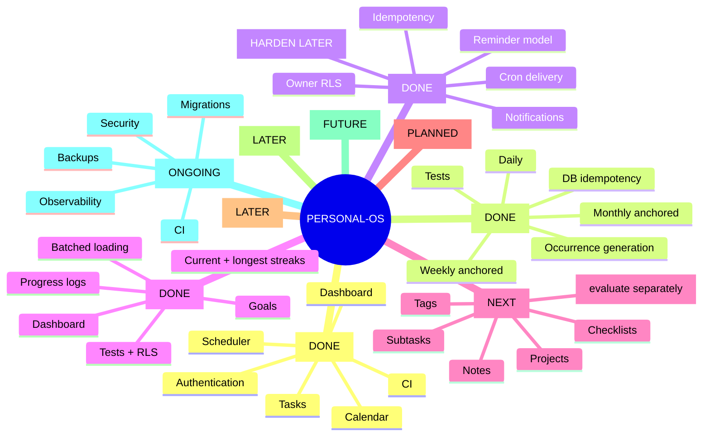

# Personal-OS — Persistent Project State

> Canonical recovery checkpoint. Read this before making project claims or changes.
> Last verified: 2026-10-16 (Organization V1 branch checkpoint; live database and CI rechecked).

## Current verified state

- Stable integration branch: `main`
- Current `main` commit: `b25e4250816a785e9e4dbc5bf124d72d34b9a476` (`fix: restrict rls_auto_enable client execution`).
- Recurring Tasks V1 — **merged** (PR #5).
- Reminders V1 — **merged** (PR #7).
- Progress & Streaks V1 — **merged** (PR #8).
- Security issue #6 — **closed/completed** after client execution was revoked for `public.rls_auto_enable()` and security verification reported 0 lints.
- Open GitHub issue backlog — **0** at last verification.
- Latest verified CI on `main` — **successful**; tests and production build passed.
- No feature branch is currently required for the completed Progress & Streaks milestone.

## Source-of-truth hierarchy

1. Actual GitHub repository and branch contents
2. Actual Supabase schema/data contract
3. CI/test results
4. `PROJECT_STATE.md`
5. `PROJECT_ROADMAP.md`
6. Chat history/memory

If sources disagree, verify the higher-priority source. Never guess.

## Anti-confusion protocol

Before every substantial change:
1. Read roadmap and project state.
2. Verify active branch and PR state.
3. Inspect relevant code.
4. Verify live Supabase schema for DB changes.
5. Make the smallest safe change.
6. Run CI/tests/build where applicable.
7. Re-read changed files and verify the result.
8. Update this checkpoint after milestones.
9. Never report a change as verified until the authoritative system confirms it.

Branches are not PRs. A Compare & pull request button only means a branch has changes relative to its base.

## Completed milestones

### Recurring Tasks V1 — COMPLETE
- Daily, weekly and monthly recurrence rules.
- Weekly cycle anchoring.
- Monthly day 29–31 clamping with preserved anchor day.
- Recurrence validation and creation UI.
- Next-occurrence generation after completion.
- Activity events and guarded completion updates.
- Shared recurrence types and regression tests.
- Supabase partial unique index for recurring occurrence idempotency.
- PostgreSQL `23505` handling.
- Reproducible migration.
- V1 occurrence-only editing semantics.
- Full timezone/DST recurrence semantics remain deferred.

### Reminders V1 — COMPLETE
- Owner-scoped reminders and notifications with RLS.
- Task ownership validation.
- Scheduled timestamp + timezone field.
- `IN_APP` channel.
- Upcoming-reminder query and server action boundary.
- Authenticated cron delivery endpoint.
- Durable notification records and delivery idempotency.
- Activity events, dashboard scheduling/upcoming UI.
- Validation tests, cron configuration and CI verification.
- Full user-local timezone/DST semantics remain a hardening item.

### Progress & Streaks V1 — COMPLETE
- Generic measurable goals with positive targets.
- Positive progress entries with date validation.
- Current and longest streak calculations; duplicate entries on one day count once.
- Dashboard goal cards, progress logging, percentage and streak display.
- Goals/progress migration with owner-scoped RLS and positive-value constraints.
- Batched dashboard loading to avoid N+1 progress queries.
- Authenticated `user_id` enforced at the service boundary.
- Progress unit tests included in the repository test command.
- PR #8 merged to `main`.

## Security / hardening status

- `public.rls_auto_enable()` client execution restricted; security issue #6 closed.
- Security verification reported 0 advisor lints after remediation.
- Foreign-key indexing/performance findings should still be reviewed during production hardening.
- CI/build must remain a merge gate for future work.

## Roadmap

1. Recurring Tasks V1 — DONE
2. Reminders V1 — DONE
3. Progress & Streaks V1 — DONE
4. **Organization V1 — NEXT**
5. Analytics V1
6. AI Assistant V1
7. Research Agent V1
8. Adaptive Scheduling
9. Production hardening

## Mind tree

## Definition of done — every feature

A feature is not complete merely because the UI works. Where applicable, verify:
1. Data model/schema
2. Authorization/RLS
3. Backend/application logic
4. Edge cases and failure states
5. Unit/integration/regression tests
6. UI/UX
7. CI/build
8. Migration/recovery implications
9. Documentation + `PROJECT_STATE.md`

## Future-session rule

Never infer progress from chat wording. Verify GitHub branch/PR state, inspect relevant files, verify Supabase for data changes, verify CI, and update this checkpoint. If uncertain, mark it uncertain and continue verification rather than guessing.

## Organization V1 — current checkpoint (2026-10-16)

- Active implementation is in PR #11, `feature/organization-v1`; PR remains open and unmerged. The project-schema compatibility migration is included on this branch. Organization migration filenames were moved to `20260905170000` and `20260905170100` so they sort after the latest already-applied remote migration (`20260905162251`) and before the October hardening migrations. PR #12 contains the same migration on a child branch and is redundant; do not merge it separately.
- Implemented in this branch: owner-scoped projects, project/task associations, task subtasks, checklist UI and server actions, database-level ownership/link validation, checklist ownership hardening, legacy checklist reconciliation, cycle prevention, and input validation tests.
- Verified GitHub Actions run #82 passed install, tests, and production build for commit `54d3c35404c47e7bec64f4eea1b5802c207acfe7`; run #83 passed for the subsequent documentation update. Later migration/policy edits and migration timestamp corrections were made through the repository connector and have no reported workflow run yet, so CI must be re-verified on the final head before merge.
- Live Supabase verification has been restored for the intended project `gujzvkyytxsnervovvrt` (`puttamohithkrishnaa@gmail.com's Project`, ACTIVE_HEALTHY). The unrelated `yojantra` project is not the target. The live migration ledger currently contains only the core, recurrence, reminders, RLS hardening, and goals migrations; Organization V1 migrations are NOT applied. Live `projects` uses legacy `title`, has existing status values including `COMPLETED`, and currently has no rows. Existing task project/parent columns and foreign keys are already present.
- Before merge/deployment: review migration order and compatibility; apply Organization V1 migrations to the intended Supabase project only after preflight and backup/recovery checks; run security/performance advisors; then test owner isolation plus project/subtask/checklist CRUD with authenticated users. The compatibility migration is included on this branch to bridge legacy `projects.title` to app-facing `projects.name` without dropping the old column or removing `COMPLETED` status support. Organization migration versions now sort after the existing remote ledger; this avoids requiring an out-of-order migration push.
- CI passed on earlier integrated commits, but final migration/policy edits still need a fresh CI run. Do not merge PR #11 until the final head passes CI, migration review and live database rollout plan are accepted, and authenticated end-to-end CRUD verification is complete.
